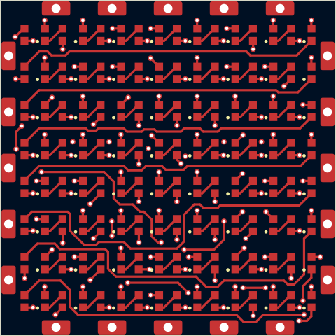

# the-better-cube

Parametric generator for tileable LED PCB tiles (KiCad 10). One YAML file per
board variant; everything else -- footprints, pinouts, design rules, the
hand-drawn back side -- is shared.

**[Browse every board and shape in the docs →](docs/README.md)**

<p>
<a href="docs/shapes/cube--sq30-3535x16-p6.2-pvia/README.md"></a>
<a href="docs/shapes/cuboctahedron--sq30-3535x16-p6.2-pvia+tri30-3535x10-p6.2-shallow-rot/README.md"></a>
<a href="docs/shapes/icosahedron--tri30-3535x10-p6.2-shallow-rot/README.md"></a>
<a href="docs/shapes/truncated-octahedron--sq30-2020x64-p3.4-tpl+hex30-2020x169-p3.7-pvia/README.md"></a>
<a href="docs/shapes/cube--sq30-2020x64-p3.4-tpl/README.md"></a>
</p>

<p>
<a href="docs/boards/tri30-3535x10-p6.2-shallow-rot/README.md"></a>
<a href="docs/boards/tri30-3535x10-p6.2-shallow-rot/README.md"></a>
<a href="docs/boards/sq30-2020x64-p3.4-tpl/README.md"></a>
<a href="docs/boards/sq30-2020x64-p3.4-tpl/README.md"></a>
</p>

```
make setup                                 # once: venv on KiCad's Python + KiKit
make all                                   # build + DRC + render + fab every board, then tests
make all BOARDS=sq30-2020x64-p3.4-tpl      # just one
make panel PANELS=tri30-mix-4             # panels from panels/*.yaml (boards built first)
make release BOARDS=sq30-2020x64-p3.4-tpl  # freeze into releases/sq30-2020x64-p3.4-tpl-A/ before ordering
```

Tool paths default to the macOS app installs and can be overridden: `make setup KICAD_PY=/path/to/kicad/python3` (a Python that can `import pcbnew`), `kicad-cli` and `blender` are taken from PATH first, and `FREEROUTING_JAR` / `KICAD10_SYMBOL_DIR` point at Freerouting and KiCad's symbol library.

## Layout

```
boards/            one YAML per variant (the only thing you normally touch)
shapes/            one YAML per demo assembly (solid + boards)
lib/
  parts.yaml       part catalog: footprint, pin map, LCSC code per part
  defaults.yaml    defaults every board inherits (stackup, rules, router...)
  tbc.pretty/      shared footprints (vendored, so KiCad updates can't move them)
  tbc.3dshapes/    3D models not in KiCad's stock library
  tbc.kicad_dru    shared custom DRC rules
  templates/       hand-drawn "chassis" boards (outline, connectors, back side)
panels/            one YAML per panel (which boards where) + KiKit presets
tbcgen/            the generator
  geometry.py      outlines, ports, LED grids, chain order (pure Python)
  board.py         pcbnew: placement, routing order, planes
  router.py        small grid A* router (front data chain, power vias)
  outputs.py       project files, DRC, renders, fab, panel, release
  panel.py         panel layouts, tabs and mousebites (on KiKit)
  models.py        board GLBs, polyhedra assembled from them
  docs.py          docs/ pages from build/
tools/
  extract_template.py   pull a chassis template out of a hand-made board
  render_glb.py    GLB -> PNG with headless Blender
tests/             catalog/geometry checks + checks on built boards
build/<board>/     generated, git-ignored: KiCad project, drc.json, renders/,
                   fab/ (gerbers zip, BOM, CPL), pixelmap.json, 3d/
build/shapes/      generated demo assemblies (GLB + PNG)
docs/              generated, committed: a page per board and per shape
releases/<board>-<rev>/   committed snapshots of what was actually ordered
```

## How a board is made

1. **Chassis.** With `template: square30` the board starts as a copy of
   `lib/templates/square30.kicad_pcb`: outline, edge connectors J1..J4, caps,
   the IN/OUT/PASS jumper hubs and all of their hand-drawn back routing. The
   generator never adds or changes anything on B.Cu; it only checks the
   template matches the board's shape (connector positions, net names).
   Without a template, the chassis and back routing are generated (works
   for any `shape`; see "Generated mode").
2. **LEDs** are placed on the grid from `leds:`, all in one orientation
   (`rotation: auto`), chained row by row (`chain: raster`). Pin roles come
   from `lib/parts.yaml`, never from the footprint's pad order.
3. **Routing** (front only): a via to the planes next to every LED power
   pad, then the data chain (shortest links first), then the chain ends to
   the template's WS_IN / WS_OUT hand-off vias. Vias avoid the back's copper.
4. **Planes**: In1 = GND, In2 = +5V, poured around everything.
5. **Check**: `kicad-cli pcb drc` (zones refilled and saved -- the gerbers
   are plotted from the saved fill), must be 0 errors and
   0 unconnected; tests check the back is bit-for-bit the template.

## Templates (the hand-drawn back side)

| template | from | for |
|---|---|---|
| `square30` | thecube/led_board_v5 | 30 mm square, sparse LEDs (5050) |
| `square30-dense` | thecube/denser_v4 | 30 mm square, 3.4 mm grid; its vias sit in the LED gaps |

The back side's through vias (the inner-layer hops) come up on the front, so
a template has to suit the LED grid -- that's why there are two. To change
the back art, open the template in KiCad, edit, save, `make all`. To start
a new one, draw it by hand in a board and run
`tools/extract_template.py SRC.kicad_pcb lib/templates/NAME.kicad_pcb`.
Template contract: centre at (100, 100), connectors J1..Jn clockwise from
the top, nets `P1..Pn, WS_IN, WS_OUT, PASS, +5V, GND`, and WS_IN/WS_OUT
each ending in a via (the generator routes from there to the first/last LED).
Template parts keep their values and BOM flags (e.g. the 10 uF caps are
excluded from BOM/CPL, as in the original boards).

## Adding a variant

```yaml
# boards/sq30-5050x9-p9-tpl.yaml
shape: square
edge: 30.0
leds: {part: ws2812b-5050, cols: 3, rows: 3, pitch: 9.0}
template: square30
```

The file name spells out the board and is checked against the config
(`tbcgen/config.py: board_name`), so a misnamed file fails to load and the
error says what to call it:

```
<shape><edge>-<package>x<leds>-p<pitch>[-<variation>...][--<note>]
tri30-3535x10-p6.2-shallow-rot
```

Variations, in this order: `tpl` hand-drawn back (template), `shallow`
shallow edge connector, `rot` / `flow` / `r<deg>` LED rotation other than
one-way auto, `pvia` patterned power vias, `fr` Freerouting. Anything after
`--` is a free note for experiments that the scheme doesn't cover.

New LED package: add the footprint to `lib/tbc.pretty`, an entry to
`lib/parts.yaml` with its `pins` map and `kicad_symbol`; the test suite
cross-checks the pin map against KiCad's stock symbol.

## Generated mode (no template)

`shape: tri | square | hex` builds connectors on every edge, caps, three
jumper hubs (`hubs:`; one jumper per port, with the square30 KiBuzzard
labels `tbc:label_in/out/pass` in the middle) and auto-routes the back. It's
the way to prototype new shapes before drawing a template; expect to tune
`hubs.jumper_radius` (6 ports need ~4.3 mm) and `leds.pitch`.

`tri30-3535x10-p5-shallow-pvia` is the worked example for a small shape: shallow connector pads
(`connector: edge_connector_shallow`, same positions and pinout, so it mates
with the squares), one cap per edge (two collide in the corners), and
three-wing hubs in the corners with `radius - jumper_radius >= 2.4` so the
inner wings' courtyards clear each other near the centre.

On a triangle the LED bodies, not the pads, set the pitch: turned all the
same way, a 3535's corner sticks out towards the slanted edges, and 5.8 mm is
the most that keeps 0.3 mm to the shallow pads. `rotation: edge` turns each
outer LED (15 deg steps) flat to its edge, splitting the difference in the
corners; `tri30-3535x10-p6.2-shallow-rot` gets 6.2 mm with 0.4 mm left (0.6
mm on the flat ones). Patterned power vias need one rotation, so it uses
nearest-spot vias.

### Dense 2020 pair (8 LEDs per side)

`tri30-2020x36-p2.95-shallow-pvia` and `sq30-2020x64-p2.95-pvia` share LED,
pitch and LEDs per side, so the triangle sets the numbers. A 2020's pads
reach 1.55 mm towards a slanted edge (more than its body), so 8 rows fit up
to ~2.97 mm pitch with 0.15 mm to the shallow connector pads; 2.95 mm leaves
0.2 mm. What it took to route:

- **Pad gaps.** Neighbouring LEDs' pads are 0.42 mm apart and DOUT/DIN sit
  diagonally opposite, so in-row links squeeze between the GND and VDD pads.
  That needs `rules: {track_width: 0.127, clearance: 0.1}` (JLC multilayer
  does 0.09/0.09).
- **Via holes.** Vias keep `hole_copper_clearance` (hole to other copper,
  default 0.25) even when `clearance` is finer: the router paints them as
  bigger copper discs. At 0.25 the via grid is too sparse for the chain's row
  returns; 0.2 (JLC's "via hole to track" minimum) routes. Default boards are
  unaffected (0.15 clearance + 0.1 annular ring = 0.25 already).
- **Courtyard.** The 2020 courtyard is pads + 0.15 mm (was + 0.25, wider
  than the 2.95 mm pitch).
- **Hubs.** The back jumpers displace patterned vias; on the square
  `hubs: {angle: 180}` displaces the fewest (125/128 patterned) and lets P4
  through. Default placement left P4 boxed in.

Experiments, 2026-10-16 (2020, 2.95 mm unless noted, 0.127/0.1 rules):

| board | change | result |
|---|---|---|
| tri 8 rows | 0.2/0.15 rules | in-row link boxed in |
| tri 8 rows | hole-copper 0.25 | row return boxed in (36/72 vias patterned) |
| tri 8 rows | hole-copper 0.2 | **DRC clean**, 57/72 patterned, ~165 s |
| tri 8 rows | 0.4/0.2 vias | port P3 fails |
| sq 8x8 | hole-copper 0.25, any of 4 hub layouts | row return fails |
| sq 8x8 | hole-copper 0.2, default hubs | P4 fails |
| sq 8x8 | hole-copper 0.2, hubs angle 90 / 180 / r6.5 / r7.5 | all **DRC clean**, ~360 s |
| tri 7 rows, 3.4 mm | default rules, hubs r5.5 / r6.5 / r5.0-5.2 / angle 180 | a port or hub boxed in |
| tri 7 rows, 3.4 mm | default rules, hubs r4.5 (jumper r2.0 / 2.4) | routes, jumper courtyards overlap |
| tri 7 rows, 3.4 mm | 0.127/0.1, hole-copper 0.25 | P3 fails |
| tri 7 rows, 3.4 mm | 0.127/0.1, hole-copper 0.2 | **DRC clean**, 54/56 patterned: `tri30-2020x28-p3.4-shallow-pvia` |
| sq 7x7, 3.4 mm | default rules | row return fails |

### Hexagons

Same 30 mm edge, so a hexagon mates with every other tile (truncated
octahedron: squares + hexagons; truncated tetrahedron: triangles +
hexagons). LEDs sit on a hex lattice in `rings` (1, 7, 19, 37, ... 3n(n-1)+1),
rows parallel to the top and bottom edges. All six sides of the lattice face
an edge, so towards the four slanted edges a square package reaches 1.37 x
half its size (the 2020's pads: 1.55 mm). The pitch for a ring count is the
widest that keeps that clear of the connector pads:

| board | LEDs | pitch | to the pads | why |
|---|---|---|---|---|
| `hex30-5050x37-p8-pvia` | 4 rings, 37 | 8.0 mm (max ~8.05) | 0.4 mm | 5 rings need ~6 mm: bodies 0.2 mm apart |
| `hex30-2020x169-p3.7-pvia` | 8 rings, 169 | 3.7 mm (max ~3.77) | 0.6 mm | same LED density as the 8x8 at 3.4 mm |

The back is the hard part. Each of the six ports has a jumper on all three
hubs, so port nets and hubs form a K3,6, which needs at least six crossings:
In2 hops, each needing two via spots free on every layer. The 5050 board
and the 2020 at 3.7 mm have them; a 2020 field at 3.3-3.4 mm doesn't.
Hubs: `jumper_radius: 4.3` for six jumpers, `radius: 8` keeps the three
rings apart.

Experiments, 2026-10-16 (generated back, patterned vias):

| board | change | result |
|---|---|---|
| 5050, 4 rings, 8.0 mm | default rules and hubs | **DRC clean**, 62/74 vias patterned, ~135 s |
| 2020, 9 rings (217), 3.3 mm, shallow | 0.127/0.1, hole-copper 0.2 | P2 boxed in on the back |
| 2020, 9 rings, 3.3 mm, shallow | same, hubs angle 240 (IN by D1, OUT by the last LED) | P2 boxed in |
| 2020, 8 rings (169), 3.4 mm | default rules, hubs angle 0 / 240 | P2 / P3 boxed in |
| 2020, 8 rings, 3.7 mm | default rules or 0.127/0.1, hubs angle 0 or 240 | all four route (~400 s run 4 at once); default rules + hubs: **DRC clean**, 329/338 patterned, ~180 s alone |

The generated hex board is 3.5x the square's area, so the router's grid
is too: `Grid._window` now prepares its shapes before testing grid points
(~40x faster on board-sized polygons like the data corridors; same result).

## Panels

`panels/<name>.yaml` puts built boards on one panel (`make panel`, output in
`build/panels/<name>/`: the panel, `panel.png`, JLC gerbers, BOM and CPL with
per-board designators `D1_3`, and a DRC report):

```yaml
preset: jlc-rails      # panels/jlc-rails.json: 5mm rails, tooling, fiducials, mousebite style
layout: tri            # grid | tri (rows alternating apex up/down, nested)
board: tri30-3535x10-p6.2-shallow-rot
rows: 2
cols: 5
space: 2.0             # mm between boards and to the rails
max_size: [100, 100]   # fail if the panel comes out bigger
# or, mixed: boards: [[a, b, c, d], ...] instead of board/rows/cols
```

| panel | size | boards |
|---|---|---|
| `sq30-2020x64-p3.4-tpl-3x2` | 94 x 76 mm | 6 |
| `sq30-3535x16-p6.2-pvia-3x2` | 94 x 76 mm | 6 |
| `tri30-3535x10-p6.2-shallow-rot-2x5` | 99.2 x 68.0 mm | 10 (3 rows, 15, still fit 100 x 100) |
| `tri30-mix-4` | 81.9 x 40.0 mm | one of each triangle |

The connector pads take the middle 22.5 mm of every edge, so tabs only fit in
the ~3.7 mm next to each corner (measured per board). Mousebites have to
cover the whole joint -- tab plus the fillets a 2 mm cutter leaves either side
(`post.millradius`), and at a junction of triangle corners everything the
cutter can't reach -- so the cut lines are read off the panel as milled, not
planned: any joint that would reach copper fails the build. Holes sit just
outside the board edge (`offset: -0.25mm`), clear of the inner planes, so
expect small nubs near the corners after breaking out. A mixed panel's DRC
uses the finest rules among its boards (each has passed its own DRC).

## Router engines

`router.engine: internal` (default) is the in-house grid router.
`router.engine: freerouting` round-trips through Specctra DSN/SES with
Freerouting 2.x run headless (`--gui.enabled=false`, neckdown off; extra
settings via `router.freerouting_settings`). Template copper is locked and
nets are restricted to F.Cu (`use_layer`); the template's inner-layer hops
are swapped for via keep-outs (2.x refuses planes that carry traces) and
restored exactly after the SES import, along with the rest of the template.
Data-chain links it leaves open are finished by the in-house router.

Experiments, 2026-10-16:

| board | engine | result |
|---|---|---|
| sq30-5050x16-p7.112, template | internal | DRC clean, 223 mm front track, 38 vias |
| sq30-5050x16-p7.112, template | Freerouting 1.5 | DRC clean after 1 link finished in-house; 265 mm, 35 vias |
| sq30-2020x64-p3.4, template | internal | DRC clean |
| sq30-2020x64-p3.4, template | Freerouting 1.5 | 6 links open, one boxed in: fails |
| sq30-5050x16-p7.112, template | Freerouting 2.5 | 13 power pads never reach a plane: fails |
| sq30-5050x16-p7.112, generated | internal | DRC clean, 209 mm front + 178 mm back, 47 vias, 31 s |
| sq30-5050x16-p7.112, generated | Freerouting 2.5 | 6 unconnected (power, port nets); 393 mm front track |
| sq30-2020x64-p3.4, generated | internal | fails (P4 has no path through 128 power vias) |
| sq30-2020x64-p3.4, generated | Freerouting 2.5 | 15 unrouted, finish step can't close D48->D49: fails |

Takeaways: on these boards the constraint is the data chain fencing the
front, which needs short In2 hops; Freerouting can't use In2 (KiCad exports
it as a plane) and 2.5 additionally struggles to fan power pads into planes.
The dense 8x8 only works with the hand-drawn dense template.

## Power-via placement

`router.power_vias: nearest` (default) gives each LED power pad a via at the
closest free spot. `pattern` (`tbcgen/vias.py`) reserves corridors for the
data chain (in-row links + a return band per row gap), then picks one
LED-relative VDD/GND via offset that fits the most LEDs against everything
already on the board (template back copper, pads, edge, holes) and repeats it
on every LED; misfits get the nearest spot outside the corridors. On the 2020
it chooses both vias under the LED body, between the pad columns.

Experiments, 2026-10-16:

| board | vias | result | front track | F.Cu segments | time |
|---|---|---|---|---|---|
| sq30-5050x16-p7.112, template | nearest | DRC clean | 222 mm | 142 | ~55 s |
| sq30-5050x16-p7.112, template | pattern | DRC clean (26/32 vias by pattern) | 241 mm | 111 | ~94 s |
| sq30-2020x64-p3.4, template | nearest | DRC clean | 439 mm | 556 | ~52 s |
| sq30-2020x64-p3.4, template | pattern | DRC clean (104/128 by pattern) | 452 mm | 438 | ~270 s |
| sq30-2020x64-p3.4, generated back | nearest | fails (P4 can't cross the back) | -- | -- | -- |
| sq30-2020x64-p3.4, generated back | pattern | **DRC clean**, 2.9 mm on In2 | 428 mm | 397 | ~260 s |

Patterned vias line up in columns on the back, which leaves channels for
the port/hub routing: the only way the dense board routes without a
hand-drawn template. On template boards the gain is mostly tidiness.

Pitfall seen while testing: routing the chain ends before the data chain
let a WS_OUT hop on In2 cut a +5V island off the plane (DRC: unconnected).
In2 hops are cheap but must not enclose plane areas.

## 3D models (demo / docs)

```
make model                                   # build/<board>/3d/<board>.glb for every built board
make shapes                                  # build/shapes/<shape>.glb for every shapes/*.yaml
make shapes SHAPES=cube--sq30-2020x64-p3.4-tpl
```

A shape is a small file in `shapes/`, named like a board from what's in it
(`<solid>--<square board>+<tri board>`, checked on load); its header
comment becomes its description in the docs:

```yaml
# shapes/cube--sq30-2020x64-p3.4-tpl.yaml
# The dense cube: six 8x8 2020 tiles on the hand-drawn dense back, 384 LEDs.
solid: cube
boards: {square: sq30-2020x64-p3.4-tpl}
```

Solids: tetrahedron, cube, octahedron, icosahedron, square-pyramid,
triangular-prism, cuboctahedron, hexagonal-prism, truncated-tetrahedron,
truncated-octahedron (`tbcgen/models.py: SHAPES`; any solid whose faces are
regular triangles, squares and hexagons can be added as a vertex list).
A shape names its boards `<square>+<tri>+<hex>`, only those the solid uses.
Each tile sits with its board bottom on the face and LEDs out, so neighbours
meet along their inner edges, as on a real build. A board's GLB is merged
per material and instanced on every face, so a solid's file is about the
size of one tile per board type. GLBs open in Blender or any glTF viewer
(Finder / Quick Look don't preview them).

With Blender installed (`blender` on PATH or /Applications/Blender.app),
both commands also write a PNG preview next to each GLB:
`tools/render_glb.py` runs headless (Cycles on CPU, transparent background,
three-quarter view fitted to the model), ~10 s per board and ~35 s per solid
at 1200 px. Render any GLB by hand with
`blender -b --factory-startup -P tools/render_glb.py -- in.glb out.png 1200`.

## Docs

`make docs` writes [docs/](docs/README.md) from `build/`: an index, a page
per board (description from its YAML header comment, config, name breakdown,
DRC and routing numbers, top/bottom renders, the four copper layers, 3D
render, pixel map) and a page per shape (render, tiles and LED count, links
to its boards). Images are copied next to each page, so docs/ is
self-contained and meant to be committed. Full refresh:

```
make all model shapes docs
```

## Practices this repo follows

- **Single source of truth** per concern: pinouts in `parts.yaml`, rules in
  `defaults.yaml`, connector/back art in templates. Boards only say what
  differs.
- **Vendored libraries**: footprints and 3D models live in the repo; boards
  reference `tbc:` via a project-relative `fp-lib-table`.
- **Generated files are disposable** (`build/` is ignored); what was ordered
  is frozen in `releases/` with its config, DRC report and fab files.
- **DRC + tests gate everything**; failing routes save
  `build/<board>/<board>-failed.kicad_pcb` for inspection.
- **pixelmap.json** per board gives firmware LED index -> x/y (mm from the
  board centre, y down) and port positions.

## Known limits

- The router is a simple grid A* without rip-up: dense boards depend on
  route order; it fails loudly rather than producing a bad board.
- Front routing is functional rather than pretty, especially the row return
  traces on 8x8.
- JLC CPL rotations come straight from KiCad (`jlc_rotation` per part to
  correct); check the JLC assembly preview on the first order of a package.
