# the-better-cube docs

Generated by `make docs` from `build/` (run `make all model shapes` first); don't edit by hand.

## Boards

| | Board | LEDs | Pitch | DRC |
|---|---|---|---|---|
| 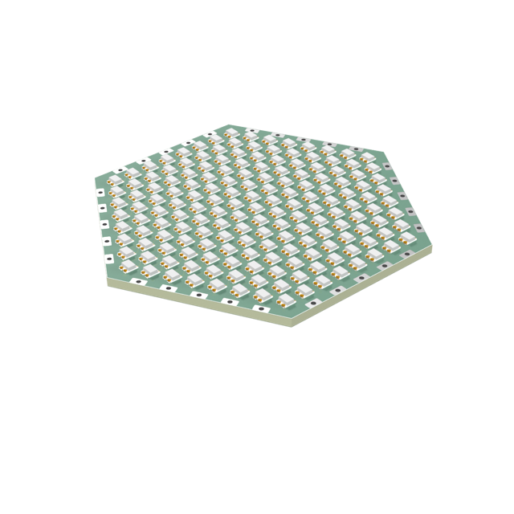 | [hex30-2020x169-p3.7-pvia](boards/hex30-2020x169-p3.7-pvia/README.md) | 169 | 3.7 mm | 0 errors, 0 warnings, 0 unconnected |
| 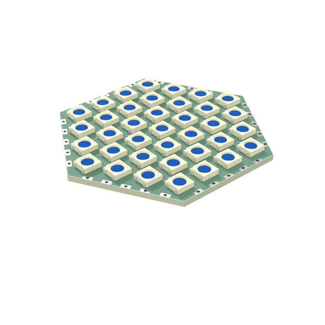 | [hex30-5050x37-p8-pvia](boards/hex30-5050x37-p8-pvia/README.md) | 37 | 8 mm | 0 errors, 0 warnings, 0 unconnected |
| 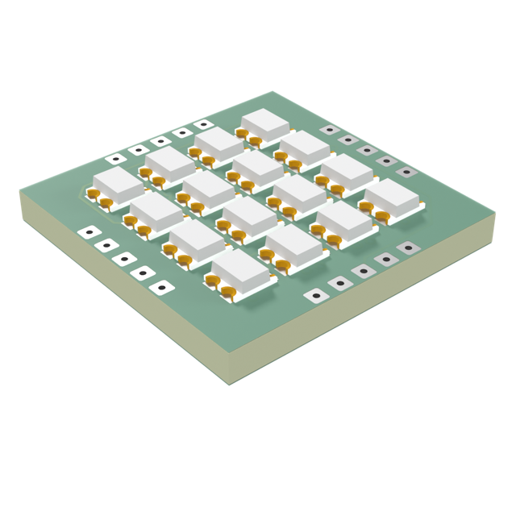 | [sq15-2020x16-p2.85-micro-pvia](boards/sq15-2020x16-p2.85-micro-pvia/README.md) | 16 | 2.85 mm | 0 errors, 0 warnings, 0 unconnected |
| 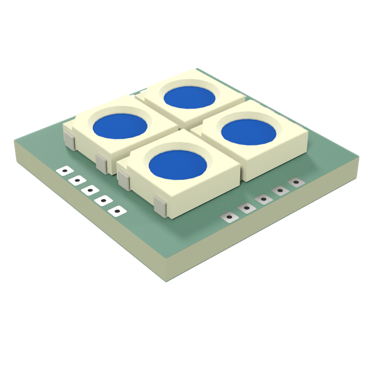 | [sq15-5050x4-p5.5-micro-pvia](boards/sq15-5050x4-p5.5-micro-pvia/README.md) | 4 | 5.5 mm | 0 errors, 0 warnings, 0 unconnected |
| 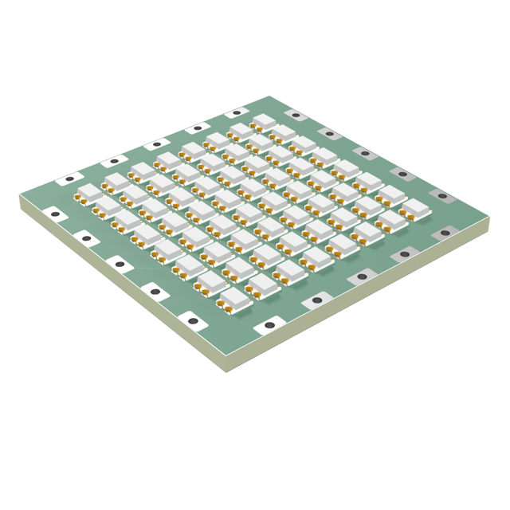 | [sq30-2020x64-p2.95-pvia](boards/sq30-2020x64-p2.95-pvia/README.md) | 64 | 2.95 mm | 0 errors, 0 warnings, 0 unconnected |
| 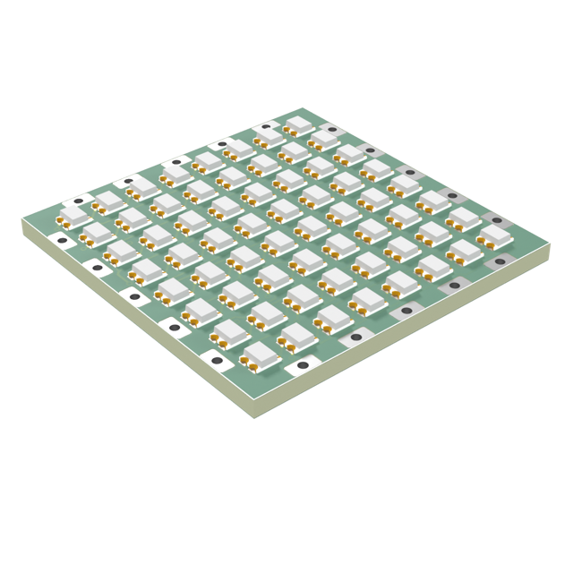 | [sq30-2020x64-p3.4-tpl](boards/sq30-2020x64-p3.4-tpl/README.md) | 64 | 3.4 mm | 0 errors, 0 warnings, 0 unconnected |
| 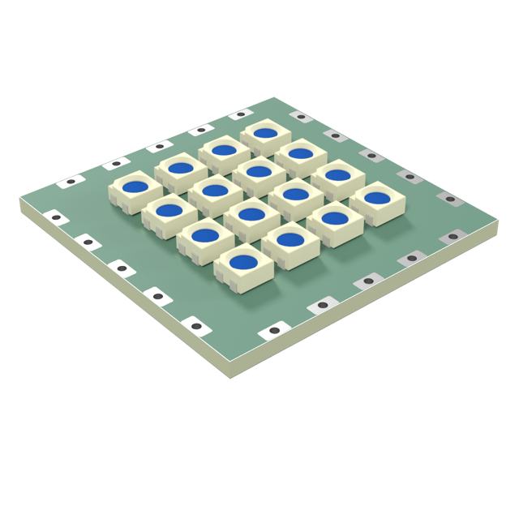 | [sq30-3535x16-p5-pvia](boards/sq30-3535x16-p5-pvia/README.md) | 16 | 5 mm | 0 errors, 0 warnings, 0 unconnected |
| 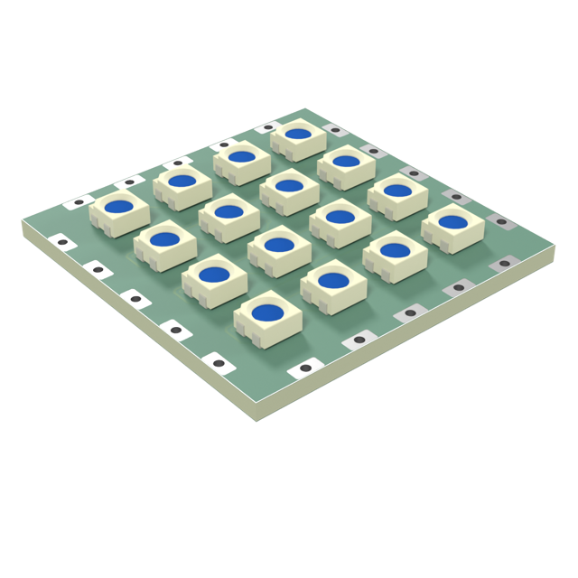 | [sq30-3535x16-p6.2-pvia](boards/sq30-3535x16-p6.2-pvia/README.md) | 16 | 6.2 mm | 0 errors, 0 warnings, 0 unconnected |
|  | [sq30-5050x16-p7.112-tpl](boards/sq30-5050x16-p7.112-tpl/README.md) | 16 | 7.112 mm | 0 errors, 0 warnings, 0 unconnected |
| 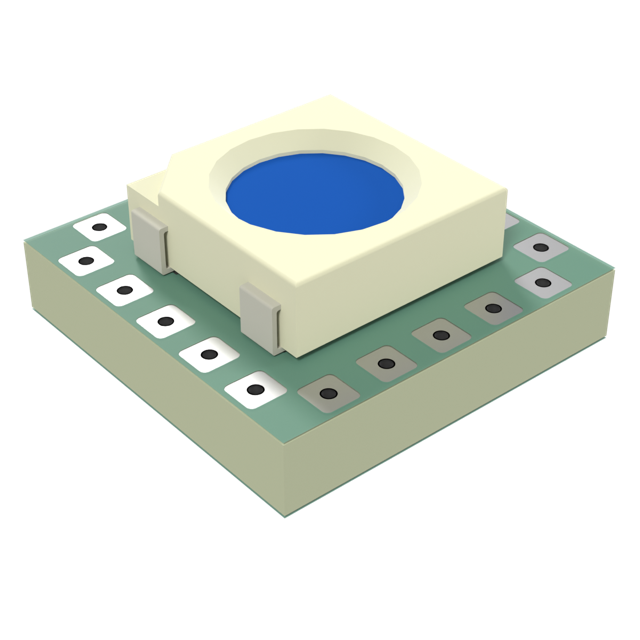 | [sq8-5050x1-p5.5-micro-grp-nopass-pvia](boards/sq8-5050x1-p5.5-micro-grp-nopass-pvia/README.md) | 1 | 5.5 mm | 0 errors, 0 warnings, 0 unconnected |
| 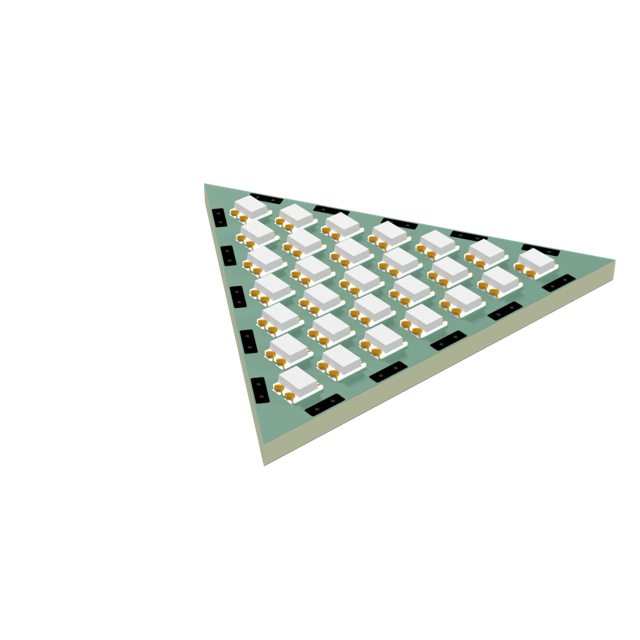 | [tri30-2020x28-p3.4-shallow-pvia](boards/tri30-2020x28-p3.4-shallow-pvia/README.md) | 28 | 3.4 mm | 0 errors, 0 warnings, 0 unconnected |
|  | [tri30-2020x36-p2.95-shallow-pvia](boards/tri30-2020x36-p2.95-shallow-pvia/README.md) | 36 | 2.95 mm | 0 errors, 0 warnings, 0 unconnected |
|  | [tri30-3535x10-p5-shallow-pvia](boards/tri30-3535x10-p5-shallow-pvia/README.md) | 10 | 5 mm | 0 errors, 0 warnings, 0 unconnected |
| 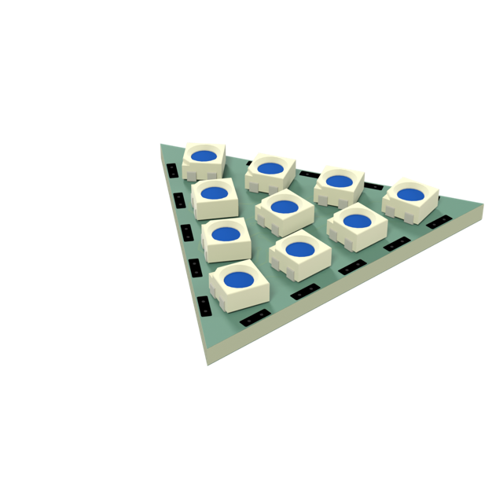 | [tri30-3535x10-p6.2-shallow-rot](boards/tri30-3535x10-p6.2-shallow-rot/README.md) | 10 | 6.2 mm | 0 errors, 0 warnings, 0 unconnected |

## Shapes

| | Shape | LEDs |
|---|---|---|
| 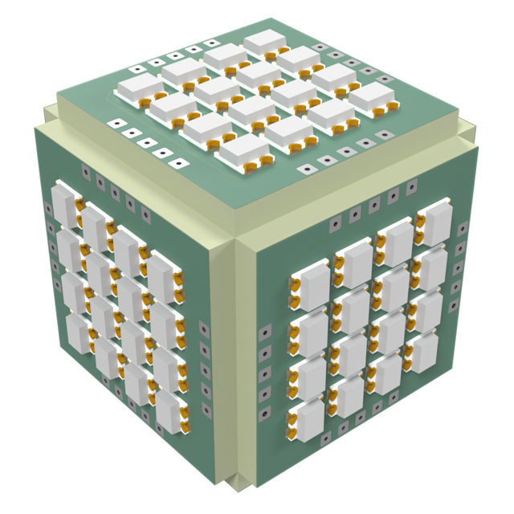 | [cube--sq15-2020x16-p2.85-micro-pvia](shapes/cube--sq15-2020x16-p2.85-micro-pvia/README.md) | 96 |
| 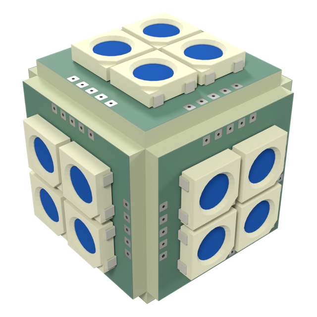 | [cube--sq15-5050x4-p5.5-micro-pvia](shapes/cube--sq15-5050x4-p5.5-micro-pvia/README.md) | 24 |
| 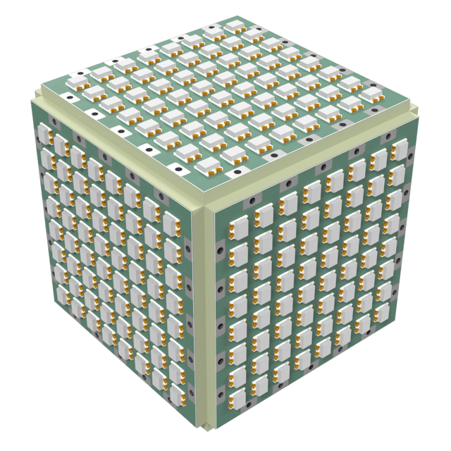 | [cube--sq30-2020x64-p3.4-tpl](shapes/cube--sq30-2020x64-p3.4-tpl/README.md) | 384 |
| 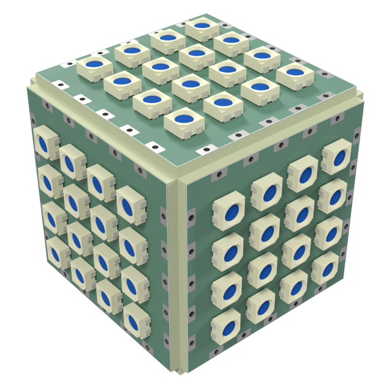 | [cube--sq30-3535x16-p6.2-pvia](shapes/cube--sq30-3535x16-p6.2-pvia/README.md) | 96 |
| 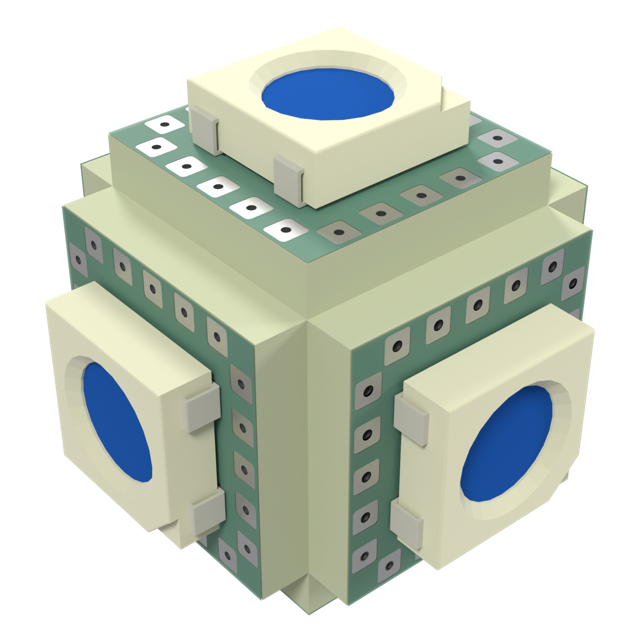 | [cube--sq8-5050x1-p5.5-micro-grp-nopass-pvia](shapes/cube--sq8-5050x1-p5.5-micro-grp-nopass-pvia/README.md) | 6 |
| 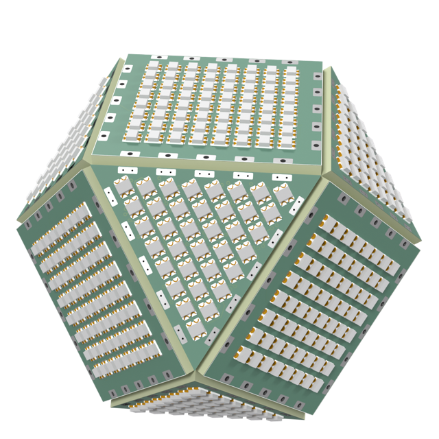 | [cuboctahedron--sq30-2020x64-p2.95-pvia+tri30-2020x36-p2.95-shallow-pvia](shapes/cuboctahedron--sq30-2020x64-p2.95-pvia+tri30-2020x36-p2.95-shallow-pvia/README.md) | 672 |
| 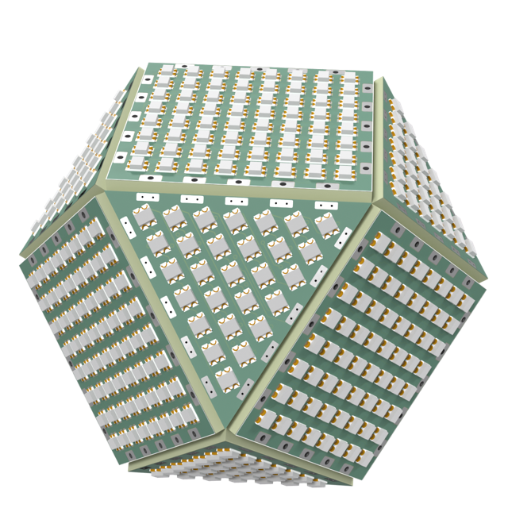 | [cuboctahedron--sq30-2020x64-p3.4-tpl+tri30-2020x28-p3.4-shallow-pvia](shapes/cuboctahedron--sq30-2020x64-p3.4-tpl+tri30-2020x28-p3.4-shallow-pvia/README.md) | 608 |
|  | [cuboctahedron--sq30-3535x16-p6.2-pvia+tri30-3535x10-p6.2-shallow-rot](shapes/cuboctahedron--sq30-3535x16-p6.2-pvia+tri30-3535x10-p6.2-shallow-rot/README.md) | 176 |
| 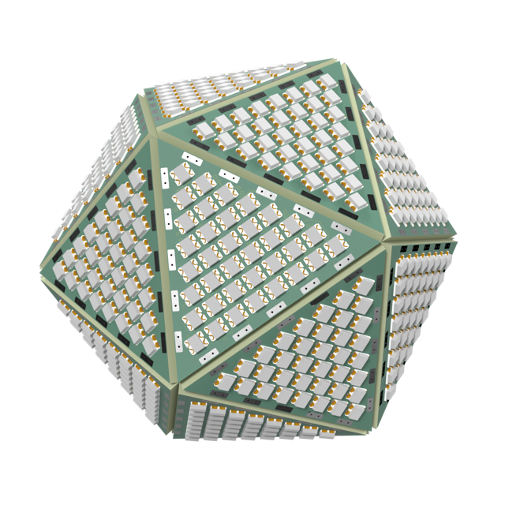 | [icosahedron--tri30-2020x36-p2.95-shallow-pvia](shapes/icosahedron--tri30-2020x36-p2.95-shallow-pvia/README.md) | 720 |
| 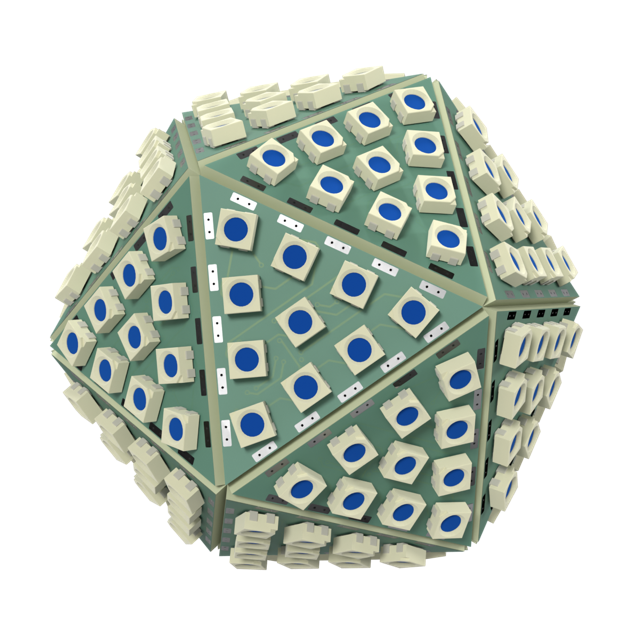 | [icosahedron--tri30-3535x10-p6.2-shallow-rot](shapes/icosahedron--tri30-3535x10-p6.2-shallow-rot/README.md) | 200 |
| 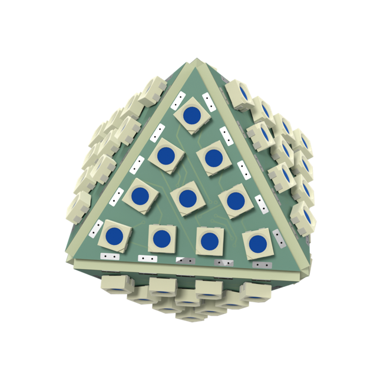 | [octahedron--tri30-3535x10-p6.2-shallow-rot](shapes/octahedron--tri30-3535x10-p6.2-shallow-rot/README.md) | 80 |
| 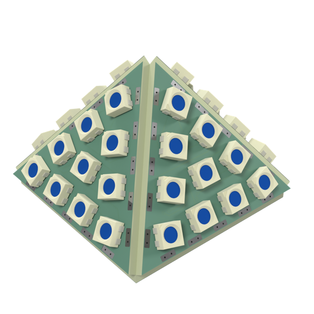 | [square-pyramid--sq30-3535x16-p6.2-pvia+tri30-3535x10-p6.2-shallow-rot](shapes/square-pyramid--sq30-3535x16-p6.2-pvia+tri30-3535x10-p6.2-shallow-rot/README.md) | 56 |
| 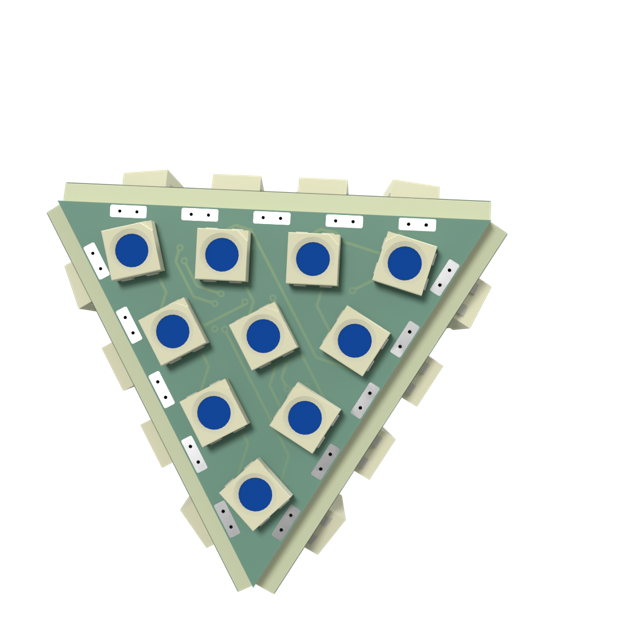 | [tetrahedron--tri30-3535x10-p6.2-shallow-rot](shapes/tetrahedron--tri30-3535x10-p6.2-shallow-rot/README.md) | 40 |
| 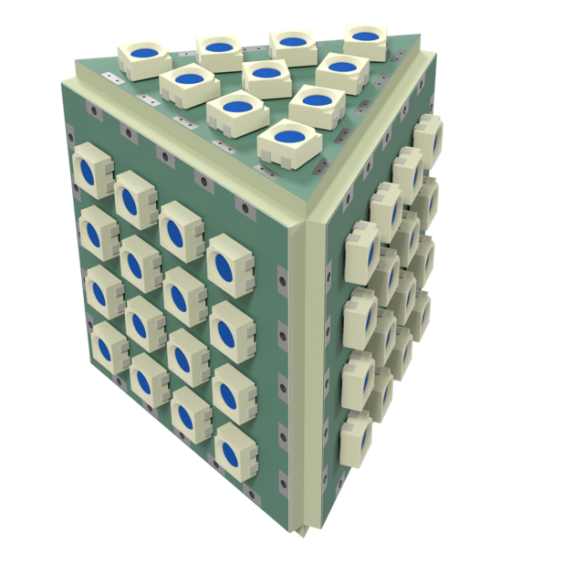 | [triangular-prism--sq30-3535x16-p6.2-pvia+tri30-3535x10-p6.2-shallow-rot](shapes/triangular-prism--sq30-3535x16-p6.2-pvia+tri30-3535x10-p6.2-shallow-rot/README.md) | 68 |
| 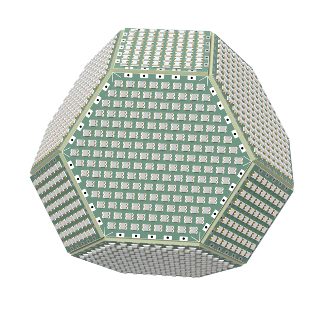 | [truncated-octahedron--sq30-2020x64-p3.4-tpl+hex30-2020x169-p3.7-pvia](shapes/truncated-octahedron--sq30-2020x64-p3.4-tpl+hex30-2020x169-p3.7-pvia/README.md) | 1736 |
| 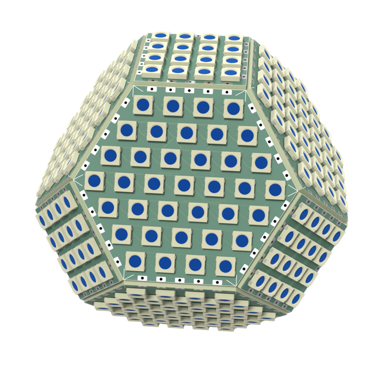 | [truncated-octahedron--sq30-5050x16-p7.112-tpl+hex30-5050x37-p8-pvia](shapes/truncated-octahedron--sq30-5050x16-p7.112-tpl+hex30-5050x37-p8-pvia/README.md) | 392 |
