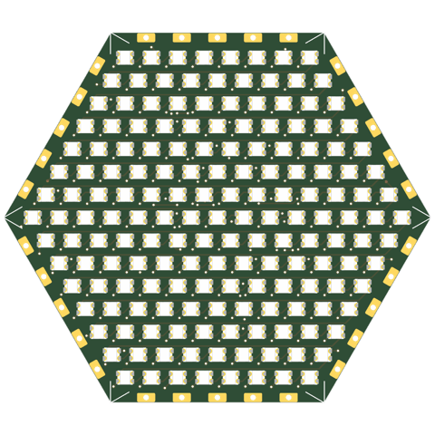
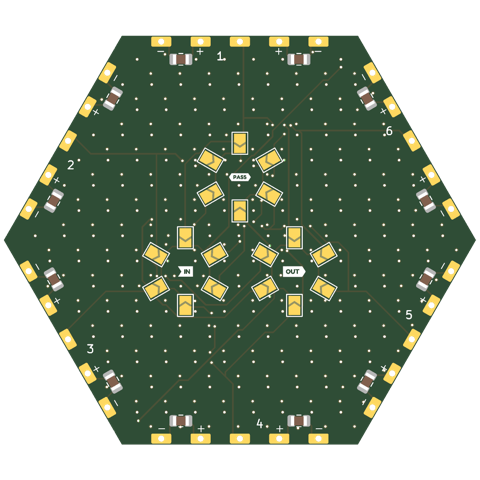
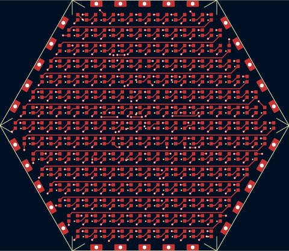
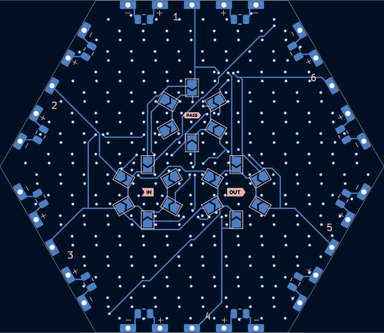
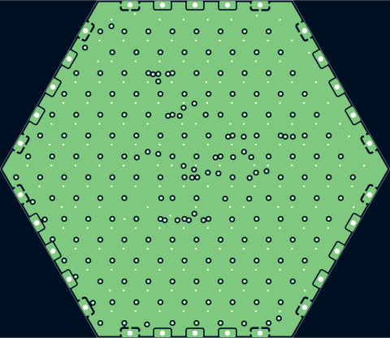
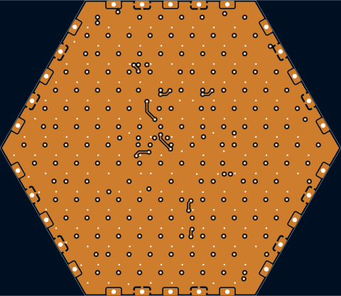

# hex30-2020x169-p3.7-pvia

Hexagon tile, 8 rings (169) of WS2812B-2020 at 3.7mm pitch: the LED density of the 8x8 sq30-2020x64-p3.4-tpl (0.072/mm2), and 3.7mm is about the widest 8 rings go (0.6mm from the pads to the connector pads; 3.75 leaves 0.3). 9 rings (217) would need 3.3mm and doesn't route: six ports to three hubs take In2 crossings, and a 3.3-3.4mm field has no room for their vias.

## At a glance

| | |
|---|---|
| Shape | hexagon, 30 mm edge, 6 ports |
| LEDs | 169 x WS2812B-2020 (8 rings) |
| Footprint | `tbc:LED_WS2812B-2020_PLCC4_2.0x2.0mm` |
| LCSC | C52917434 |
| Pitch | 3.7 mm |
| Rotation | one rotation, DOUT to the right |
| Chain | raster |
| Edge connector | `edge_connector` (`tbc:edge_conn`) |
| Back side | generated: IN/OUT/PASS jumper hubs with 6 wings each (4.3 mm from the hub centre, hubs on a 8.0 mm circle), 2 caps per edge |
| Power vias | pattern |
| Router | internal |
| Revision | A |

## Name

| | |
|---|---|
| `hex30` | hexagon, 30 mm edge |
| `2020x169` | 169 LEDs in the 2020 package |
| `p3.7` | 3.7 mm LED pitch |
| `pvia` | patterned power vias |

## Build

| | |
|---|---|
| DRC | 0 errors, 0 warnings, 0 unconnected |
| Front track | 1218 mm |
| Back track | 414 mm |
| In2 hops | 18.1 mm |
| Vias | 366 |

## Renders

| Top | Bottom |
|---|---|
|  |  |

### Layers

| Front: F.Cu, silkscreen | Back, seen from below: B.Cu, silkscreen |
|---|---|
|  |  |

| In1: GND plane | In2: +5V plane (and a few hops) |
|---|---|
|  |  |

## Pixel map

LED index in the data chain -> position, mm from the board centre (y down, top view). Also in [pixelmap.json](pixelmap.json).

169 LEDs, 6 ports

| LED | x | y |
|---|---|---|
| 1 | -12.95 | -22.43 |
| 2 | -9.25 | -22.43 |
| 3 | -5.55 | -22.43 |
| 4 | -1.85 | -22.43 |
| 5 | 1.85 | -22.43 |
| 6 | 5.55 | -22.43 |
| 7 | 9.25 | -22.43 |
| 8 | 12.95 | -22.43 |
| 9 | -14.80 | -19.23 |
| 10 | -11.10 | -19.23 |
| 11 | -7.40 | -19.23 |
| 12 | -3.70 | -19.23 |
| 13 | 0.00 | -19.23 |
| 14 | 3.70 | -19.23 |
| 15 | 7.40 | -19.23 |
| 16 | 11.10 | -19.23 |
| 17 | 14.80 | -19.23 |
| 18 | -16.65 | -16.02 |
| 19 | -12.95 | -16.02 |
| 20 | -9.25 | -16.02 |
| 21 | -5.55 | -16.02 |
| 22 | -1.85 | -16.02 |
| 23 | 1.85 | -16.02 |
| 24 | 5.55 | -16.02 |
| 25 | 9.25 | -16.02 |
| 26 | 12.95 | -16.02 |
| 27 | 16.65 | -16.02 |
| 28 | -18.50 | -12.82 |
| 29 | -14.80 | -12.82 |
| 30 | -11.10 | -12.82 |
| 31 | -7.40 | -12.82 |
| 32 | -3.70 | -12.82 |
| 33 | 0.00 | -12.82 |
| 34 | 3.70 | -12.82 |
| 35 | 7.40 | -12.82 |
| 36 | 11.10 | -12.82 |
| 37 | 14.80 | -12.82 |
| 38 | 18.50 | -12.82 |
| 39 | -20.35 | -9.61 |
| 40 | -16.65 | -9.61 |
| 41 | -12.95 | -9.61 |
| 42 | -9.25 | -9.61 |
| 43 | -5.55 | -9.61 |
| 44 | -1.85 | -9.61 |
| 45 | 1.85 | -9.61 |
| 46 | 5.55 | -9.61 |
| 47 | 9.25 | -9.61 |
| 48 | 12.95 | -9.61 |
| 49 | 16.65 | -9.61 |
| 50 | 20.35 | -9.61 |
| 51 | -22.20 | -6.41 |
| 52 | -18.50 | -6.41 |
| 53 | -14.80 | -6.41 |
| 54 | -11.10 | -6.41 |
| 55 | -7.40 | -6.41 |
| 56 | -3.70 | -6.41 |
| 57 | 0.00 | -6.41 |
| 58 | 3.70 | -6.41 |
| 59 | 7.40 | -6.41 |
| 60 | 11.10 | -6.41 |
| 61 | 14.80 | -6.41 |
| 62 | 18.50 | -6.41 |
| 63 | 22.20 | -6.41 |
| 64 | -24.05 | -3.20 |
| 65 | -20.35 | -3.20 |
| 66 | -16.65 | -3.20 |
| 67 | -12.95 | -3.20 |
| 68 | -9.25 | -3.20 |
| 69 | -5.55 | -3.20 |
| 70 | -1.85 | -3.20 |
| 71 | 1.85 | -3.20 |
| 72 | 5.55 | -3.20 |
| 73 | 9.25 | -3.20 |
| 74 | 12.95 | -3.20 |
| 75 | 16.65 | -3.20 |
| 76 | 20.35 | -3.20 |
| 77 | 24.05 | -3.20 |
| 78 | -25.90 | 0.00 |
| 79 | -22.20 | 0.00 |
| 80 | -18.50 | 0.00 |
| 81 | -14.80 | 0.00 |
| 82 | -11.10 | 0.00 |
| 83 | -7.40 | 0.00 |
| 84 | -3.70 | 0.00 |
| 85 | 0.00 | 0.00 |
| 86 | 3.70 | 0.00 |
| 87 | 7.40 | 0.00 |
| 88 | 11.10 | 0.00 |
| 89 | 14.80 | 0.00 |
| 90 | 18.50 | 0.00 |
| 91 | 22.20 | 0.00 |
| 92 | 25.90 | 0.00 |
| 93 | -24.05 | 3.20 |
| 94 | -20.35 | 3.20 |
| 95 | -16.65 | 3.20 |
| 96 | -12.95 | 3.20 |
| 97 | -9.25 | 3.20 |
| 98 | -5.55 | 3.20 |
| 99 | -1.85 | 3.20 |
| 100 | 1.85 | 3.20 |
| 101 | 5.55 | 3.20 |
| 102 | 9.25 | 3.20 |
| 103 | 12.95 | 3.20 |
| 104 | 16.65 | 3.20 |
| 105 | 20.35 | 3.20 |
| 106 | 24.05 | 3.20 |
| 107 | -22.20 | 6.41 |
| 108 | -18.50 | 6.41 |
| 109 | -14.80 | 6.41 |
| 110 | -11.10 | 6.41 |
| 111 | -7.40 | 6.41 |
| 112 | -3.70 | 6.41 |
| 113 | 0.00 | 6.41 |
| 114 | 3.70 | 6.41 |
| 115 | 7.40 | 6.41 |
| 116 | 11.10 | 6.41 |
| 117 | 14.80 | 6.41 |
| 118 | 18.50 | 6.41 |
| 119 | 22.20 | 6.41 |
| 120 | -20.35 | 9.61 |
| 121 | -16.65 | 9.61 |
| 122 | -12.95 | 9.61 |
| 123 | -9.25 | 9.61 |
| 124 | -5.55 | 9.61 |
| 125 | -1.85 | 9.61 |
| 126 | 1.85 | 9.61 |
| 127 | 5.55 | 9.61 |
| 128 | 9.25 | 9.61 |
| 129 | 12.95 | 9.61 |
| 130 | 16.65 | 9.61 |
| 131 | 20.35 | 9.61 |
| 132 | -18.50 | 12.82 |
| 133 | -14.80 | 12.82 |
| 134 | -11.10 | 12.82 |
| 135 | -7.40 | 12.82 |
| 136 | -3.70 | 12.82 |
| 137 | 0.00 | 12.82 |
| 138 | 3.70 | 12.82 |
| 139 | 7.40 | 12.82 |
| 140 | 11.10 | 12.82 |
| 141 | 14.80 | 12.82 |
| 142 | 18.50 | 12.82 |
| 143 | -16.65 | 16.02 |
| 144 | -12.95 | 16.02 |
| 145 | -9.25 | 16.02 |
| 146 | -5.55 | 16.02 |
| 147 | -1.85 | 16.02 |
| 148 | 1.85 | 16.02 |
| 149 | 5.55 | 16.02 |
| 150 | 9.25 | 16.02 |
| 151 | 12.95 | 16.02 |
| 152 | 16.65 | 16.02 |
| 153 | -14.80 | 19.23 |
| 154 | -11.10 | 19.23 |
| 155 | -7.40 | 19.23 |
| 156 | -3.70 | 19.23 |
| 157 | 0.00 | 19.23 |
| 158 | 3.70 | 19.23 |
| 159 | 7.40 | 19.23 |
| 160 | 11.10 | 19.23 |
| 161 | 14.80 | 19.23 |
| 162 | -12.95 | 22.43 |
| 163 | -9.25 | 22.43 |
| 164 | -5.55 | 22.43 |
| 165 | -1.85 | 22.43 |
| 166 | 1.85 | 22.43 |
| 167 | 5.55 | 22.43 |
| 168 | 9.25 | 22.43 |
| 169 | 12.95 | 22.43 |

| Port | x | y | facing |
|---|---|---|---|
| P1 | -0.00 | -25.98 | -90 deg |
| P2 | 22.50 | -12.99 | -30 deg |
| P3 | 22.50 | 12.99 | 30 deg |
| P4 | 0.00 | 25.98 | 90 deg |
| P5 | -22.50 | 12.99 | 150 deg |
| P6 | -22.50 | -12.99 | -150 deg |

## Used in

- [truncated-octahedron--sq30-2020x64-p3.4-tpl+hex30-2020x169-p3.7-pvia](../../shapes/truncated-octahedron--sq30-2020x64-p3.4-tpl+hex30-2020x169-p3.7-pvia/README.md)

## Files

- config: [boards/hex30-2020x169-p3.7-pvia.yaml](../../../boards/hex30-2020x169-p3.7-pvia.yaml)
- rebuild: `make all model BOARDS=hex30-2020x169-p3.7-pvia && make docs`
- KiCad project, gerbers, BOM/CPL: `build/hex30-2020x169-p3.7-pvia/` (not committed)
