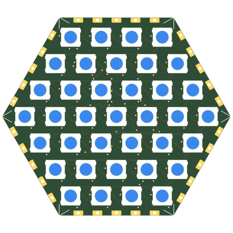
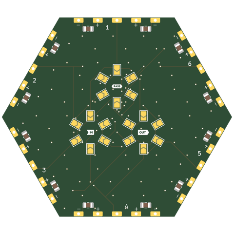
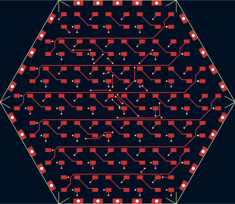
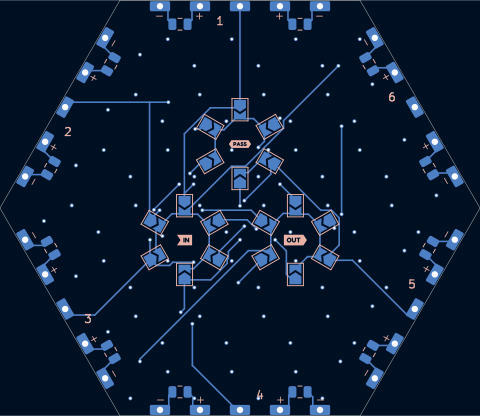
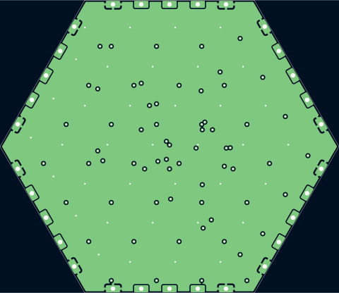
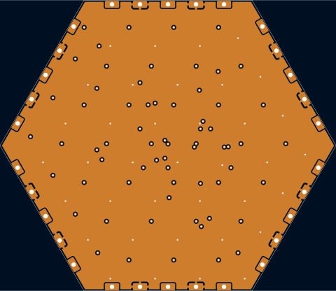

# hex30-5050x37-p8-pvia

Hexagon tile, 4 rings (37) of WS2812B 5050 at 8mm pitch: the most 5050s a 30mm hexagon takes (5 rings would need ~6mm, bodies 0.2mm apart). 8mm is the widest 4 rings go: the corner LEDs' bodies (1.37 x half a body towards a slanted edge) keep 0.4mm to the connector pads. Mates with every 30mm tile.

## At a glance

| | |
|---|---|
| Shape | hexagon, 30 mm edge, 6 ports |
| LEDs | 37 x WS2812B (4 rings) |
| Footprint | `tbc:LED_WS2812B_PLCC4_5.0x5.0mm_InnerPads` |
| LCSC | C52917433 |
| Pitch | 8 mm |
| Rotation | one rotation, DOUT to the right |
| Chain | raster |
| Edge connector | `edge_connector` (`tbc:edge_conn`) |
| Back side | generated: IN/OUT/PASS jumper hubs with 6 wings each (4.3 mm from the hub centre, hubs on a 8.0 mm circle), 2 caps per edge |
| Power vias | pattern |
| Router | internal |
| Revision | A |

## Name

| | |
|---|---|
| `hex30` | hexagon, 30 mm edge |
| `5050x37` | 37 LEDs in the 5050 package |
| `p8` | 8 mm LED pitch |
| `pvia` | patterned power vias |

## Build

| | |
|---|---|
| DRC | 0 errors, 0 warnings, 0 unconnected |
| Front track | 608 mm |
| Back track | 343 mm |
| In2 hops | 0 mm |
| Vias | 107 |

## Renders

| Top | Bottom |
|---|---|
|  |  |

### Layers

| Front: F.Cu, silkscreen | Back, seen from below: B.Cu, silkscreen |
|---|---|
|  |  |

| In1: GND plane | In2: +5V plane (and a few hops) |
|---|---|
|  |  |

## Pixel map

LED index in the data chain -> position, mm from the board centre (y down, top view). Also in [pixelmap.json](pixelmap.json).

37 LEDs, 6 ports

| LED | x | y |
|---|---|---|
| 1 | -12.00 | -20.78 |
| 2 | -4.00 | -20.78 |
| 3 | 4.00 | -20.78 |
| 4 | 12.00 | -20.78 |
| 5 | -16.00 | -13.86 |
| 6 | -8.00 | -13.86 |
| 7 | 0.00 | -13.86 |
| 8 | 8.00 | -13.86 |
| 9 | 16.00 | -13.86 |
| 10 | -20.00 | -6.93 |
| 11 | -12.00 | -6.93 |
| 12 | -4.00 | -6.93 |
| 13 | 4.00 | -6.93 |
| 14 | 12.00 | -6.93 |
| 15 | 20.00 | -6.93 |
| 16 | -24.00 | 0.00 |
| 17 | -16.00 | 0.00 |
| 18 | -8.00 | 0.00 |
| 19 | 0.00 | 0.00 |
| 20 | 8.00 | 0.00 |
| 21 | 16.00 | 0.00 |
| 22 | 24.00 | 0.00 |
| 23 | -20.00 | 6.93 |
| 24 | -12.00 | 6.93 |
| 25 | -4.00 | 6.93 |
| 26 | 4.00 | 6.93 |
| 27 | 12.00 | 6.93 |
| 28 | 20.00 | 6.93 |
| 29 | -16.00 | 13.86 |
| 30 | -8.00 | 13.86 |
| 31 | 0.00 | 13.86 |
| 32 | 8.00 | 13.86 |
| 33 | 16.00 | 13.86 |
| 34 | -12.00 | 20.78 |
| 35 | -4.00 | 20.78 |
| 36 | 4.00 | 20.78 |
| 37 | 12.00 | 20.78 |

| Port | x | y | facing |
|---|---|---|---|
| P1 | -0.00 | -25.98 | -90 deg |
| P2 | 22.50 | -12.99 | -30 deg |
| P3 | 22.50 | 12.99 | 30 deg |
| P4 | 0.00 | 25.98 | 90 deg |
| P5 | -22.50 | 12.99 | 150 deg |
| P6 | -22.50 | -12.99 | -150 deg |

## Used in

- [truncated-octahedron--sq30-5050x16-p7.112-tpl+hex30-5050x37-p8-pvia](../../shapes/truncated-octahedron--sq30-5050x16-p7.112-tpl+hex30-5050x37-p8-pvia/README.md)

## Files

- config: [boards/hex30-5050x37-p8-pvia.yaml](../../../boards/hex30-5050x37-p8-pvia.yaml)
- rebuild: `make all model BOARDS=hex30-5050x37-p8-pvia && make docs`
- KiCad project, gerbers, BOM/CPL: `build/hex30-5050x37-p8-pvia/` (not committed)
