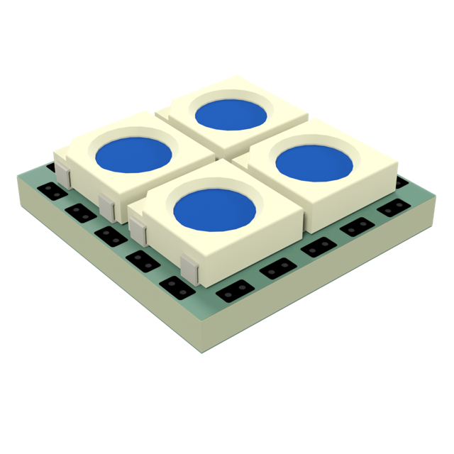
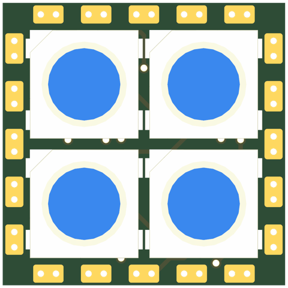
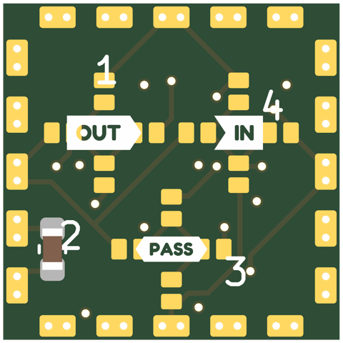
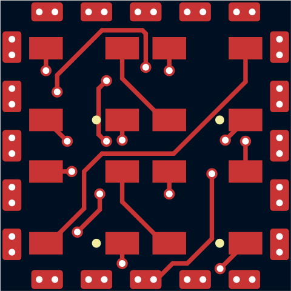
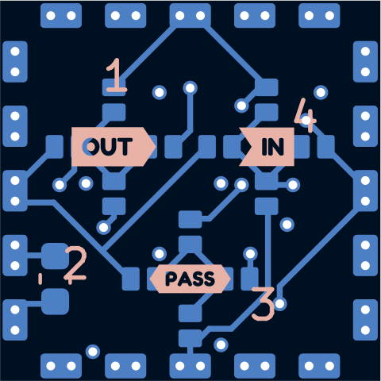
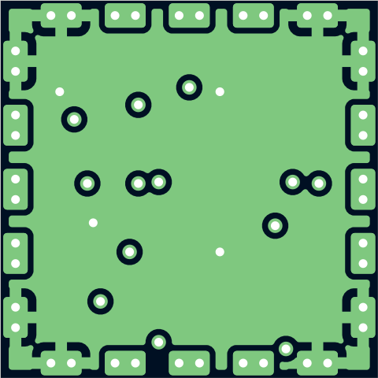
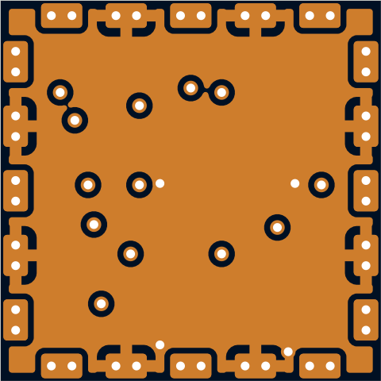

# sq13-5050x4-p5.5-mini-pvia

Smallest 5050 tile: 2x2 WS2812B at 5.5mm pitch (courtyards touching) on a 13mm square, the LED bodies 0.3mm from the mini edge connector's pads. Mates only with other mini-connector tiles.

## At a glance

| | |
|---|---|
| Shape | square, 13 mm edge, 4 ports |
| LEDs | 4 x WS2812B (2 x 2) |
| Footprint | `tbc:LED_WS2812B_PLCC4_5.0x5.0mm_InnerPads` |
| LCSC | C52917433 |
| Pitch | 5.5 mm |
| Rotation | one rotation, DOUT to the right |
| Chain | raster |
| Edge connector | `edge_connector_mini` (`tbc:edge_conn_mini`) |
| Back side | generated: IN/OUT/PASS jumper hubs with 4 wings each (1.6 mm from the hub centre, hubs on a 3.0 mm circle), 1 cap on P2 |
| Power vias | pattern |
| Router | internal |
| Revision | A |

## Name

| | |
|---|---|
| `sq13` | square, 13 mm edge |
| `5050x4` | 4 LEDs in the 5050 package |
| `p5.5` | 5.5 mm LED pitch |
| `mini` | mini edge connector (small tiles) |
| `pvia` | patterned power vias |

## Build

| | |
|---|---|
| DRC | 0 errors, 0 warnings, 0 unconnected |
| Front track | 50 mm |
| Back track | 55 mm |
| In2 hops | 0 mm |
| Vias | 17 |

## Renders

| Top | Bottom |
|---|---|
|  |  |

### Layers

| Front: F.Cu, silkscreen | Back, seen from below: B.Cu, silkscreen |
|---|---|
|  |  |

| In1: GND plane | In2: +5V plane (and a few hops) |
|---|---|
|  |  |

## Pixel map

LED index in the data chain -> position, mm from the board centre (y down, top view). Also in [pixelmap.json](pixelmap.json).

4 LEDs, 4 ports

| LED | x | y |
|---|---|---|
| 1 | -2.75 | -2.75 |
| 2 | 2.75 | -2.75 |
| 3 | -2.75 | 2.75 |
| 4 | 2.75 | 2.75 |

| Port | x | y | facing |
|---|---|---|---|
| P1 | 0.00 | -6.50 | -90 deg |
| P2 | 6.50 | 0.00 | 0 deg |
| P3 | 0.00 | 6.50 | 90 deg |
| P4 | -6.50 | 0.00 | 180 deg |

## Used in

- [cube--sq13-5050x4-p5.5-mini-pvia](../../shapes/cube--sq13-5050x4-p5.5-mini-pvia/README.md)

## Files

- config: [boards/sq13-5050x4-p5.5-mini-pvia.yaml](../../../boards/sq13-5050x4-p5.5-mini-pvia.yaml)
- rebuild: `make all model BOARDS=sq13-5050x4-p5.5-mini-pvia && make docs`
- KiCad project, gerbers, BOM/CPL: `build/sq13-5050x4-p5.5-mini-pvia/` (not committed)
