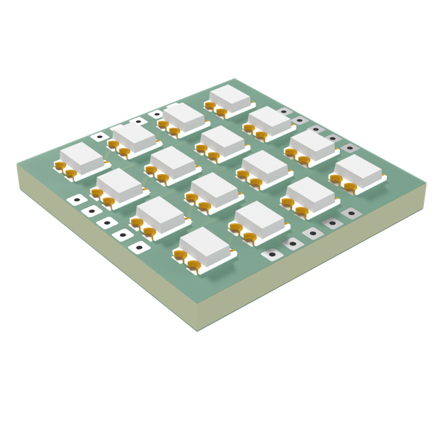
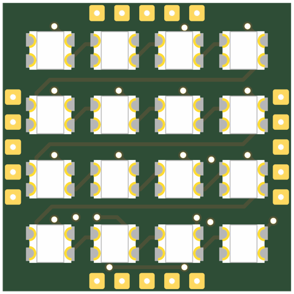
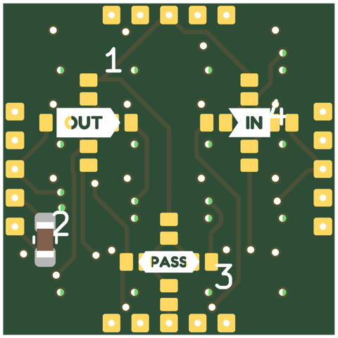
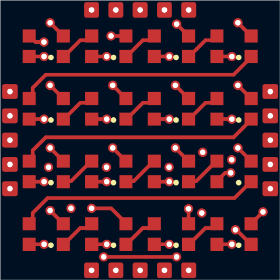
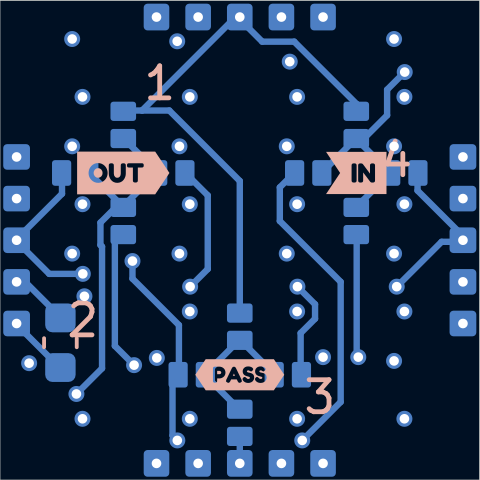
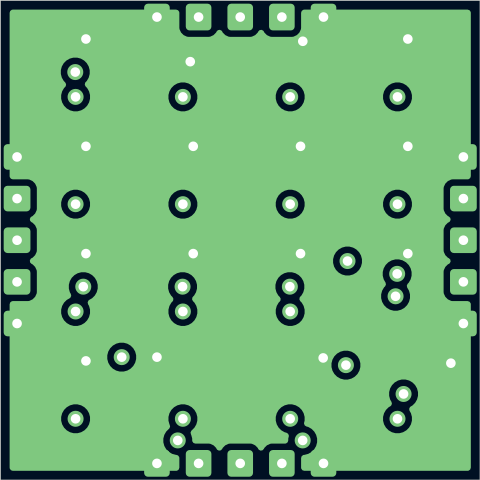
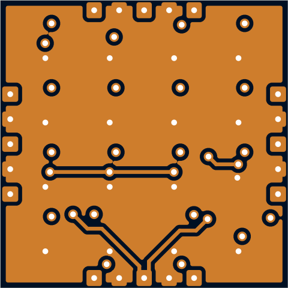

# sq15-2020x16-p3.35-micro-pvia

4x4 WS2812B-2020 on a 15mm square at 3.35mm pitch, the widest that keeps the LED pads 0.26mm from the micro edge connector's pads. (2.85mm fits a 13.5mm edge, but needs the dense pair's fine rules.)

## At a glance

| | |
|---|---|
| Shape | square, 15 mm edge, 4 ports |
| LEDs | 16 x WS2812B-2020 (4 x 4) |
| Footprint | `tbc:LED_WS2812B-2020_PLCC4_2.0x2.0mm` |
| LCSC | C52917434 |
| Pitch | 3.35 mm |
| Rotation | one rotation, DOUT to the right |
| Chain | raster |
| Edge connector | `edge_connector_micro` (`tbc:edge_conn_micro`) |
| Back side | generated: IN/OUT/PASS jumper hubs with 4 wings each (1.5 mm from the hub centre, hubs on a 4.2 mm circle), 1 cap on P2 |
| Power vias | pattern |
| Router | internal |
| Revision | A |

## Name

| | |
|---|---|
| `sq15` | square, 15 mm edge |
| `2020x16` | 16 LEDs in the 2020 package |
| `p3.35` | 3.35 mm LED pitch |
| `micro` | micro edge connector (small tiles) |
| `pvia` | patterned power vias |

## Build

| | |
|---|---|
| DRC | 0 errors, 0 warnings, 0 unconnected |
| Front track | 94 mm |
| Back track | 82 mm |
| In2 hops | 17.5 mm |
| Vias | 43 |

## Renders

| Top | Bottom |
|---|---|
|  |  |

### Layers

| Front: F.Cu, silkscreen | Back, seen from below: B.Cu, silkscreen |
|---|---|
|  |  |

| In1: GND plane | In2: +5V plane (and a few hops) |
|---|---|
|  |  |

## Pixel map

LED index in the data chain -> position, mm from the board centre (y down, top view). Also in [pixelmap.json](pixelmap.json).

16 LEDs, 4 ports

| LED | x | y |
|---|---|---|
| 1 | -5.03 | -5.03 |
| 2 | -1.68 | -5.03 |
| 3 | 1.68 | -5.03 |
| 4 | 5.03 | -5.03 |
| 5 | -5.03 | -1.68 |
| 6 | -1.68 | -1.68 |
| 7 | 1.68 | -1.68 |
| 8 | 5.03 | -1.68 |
| 9 | -5.03 | 1.68 |
| 10 | -1.68 | 1.68 |
| 11 | 1.68 | 1.68 |
| 12 | 5.03 | 1.68 |
| 13 | -5.03 | 5.03 |
| 14 | -1.68 | 5.03 |
| 15 | 1.68 | 5.03 |
| 16 | 5.03 | 5.03 |

| Port | x | y | facing |
|---|---|---|---|
| P1 | 0.00 | -7.50 | -90 deg |
| P2 | 7.50 | 0.00 | 0 deg |
| P3 | 0.00 | 7.50 | 90 deg |
| P4 | -7.50 | 0.00 | 180 deg |

## Used in

- [cube--sq15-2020x16-p3.35-micro-pvia](../../shapes/cube--sq15-2020x16-p3.35-micro-pvia/README.md)

## Files

- config: [boards/sq15-2020x16-p3.35-micro-pvia.yaml](../../../boards/sq15-2020x16-p3.35-micro-pvia.yaml)
- rebuild: `make all model BOARDS=sq15-2020x16-p3.35-micro-pvia && make docs`
- KiCad project, gerbers, BOM/CPL: `build/sq15-2020x16-p3.35-micro-pvia/` (not committed)
