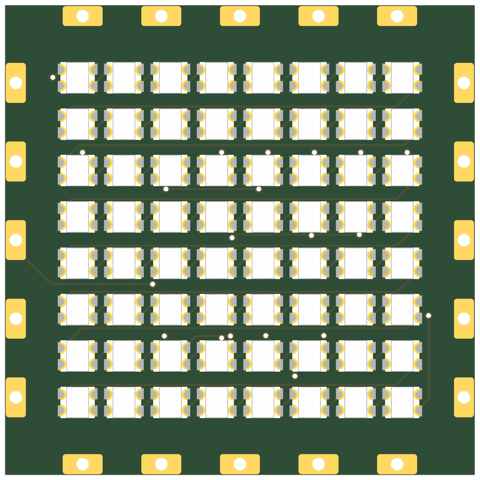
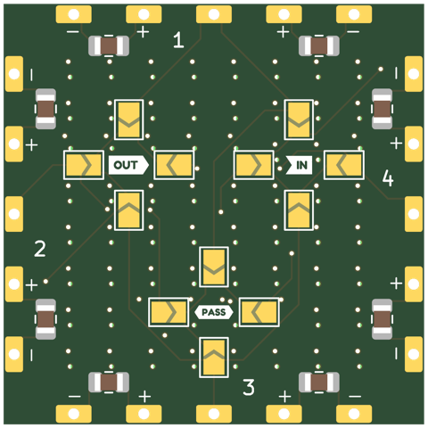
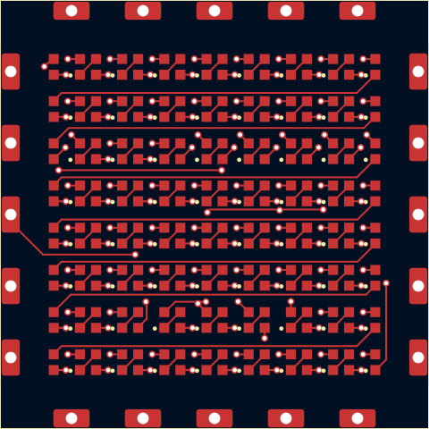
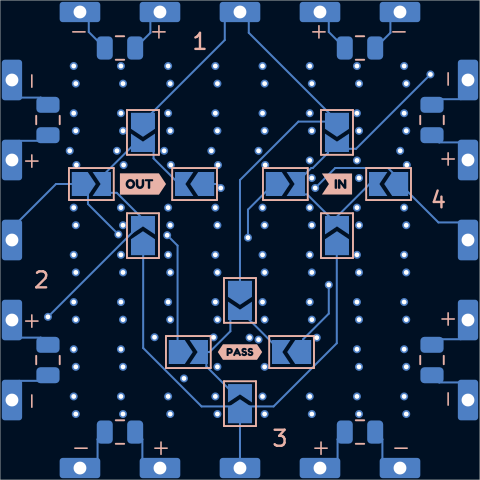
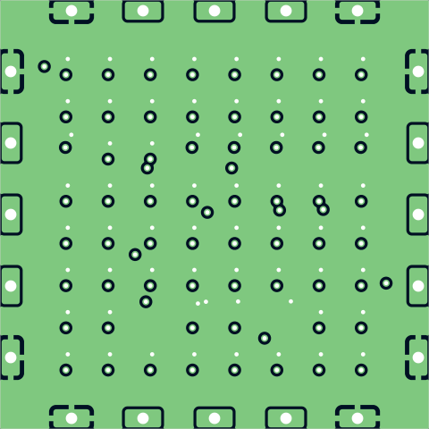
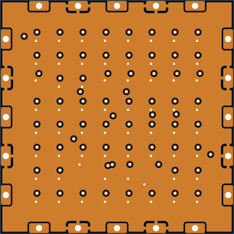

# sq30-2020x64-p2.95-pvia

8x8 WS2812B-2020 tile at 2.95mm pitch -- same LED, pitch and LEDs per side as the triangle tri30-2020x36-p2.95-shallow-pvia.

## At a glance

| | |
|---|---|
| Shape | square, 30 mm edge, 4 ports |
| LEDs | 64 x WS2812B-2020 (8 x 8) |
| Footprint | `tbc:LED_WS2812B-2020_PLCC4_2.0x2.0mm` |
| LCSC | C52917434 |
| Pitch | 2.95 mm |
| Rotation | one rotation, DOUT to the right |
| Chain | raster |
| Edge connector | `edge_connector` (`tbc:edge_conn`) |
| Back side | generated: IN/OUT/PASS jumper hubs with 4 wings each (3.225 mm from the hub centre, hubs on a 7.0 mm circle), 2 caps per edge |
| Power vias | pattern |
| Router | internal |
| Revision | A |

## Name

| | |
|---|---|
| `sq30` | square, 30 mm edge |
| `2020x64` | 64 LEDs in the 2020 package |
| `p2.95` | 2.95 mm LED pitch |
| `pvia` | patterned power vias |

## Build

| | |
|---|---|
| DRC | 0 errors, 0 warnings, 0 unconnected |
| Front track | 374 mm |
| Back track | 169 mm |
| In2 hops | 0 mm |
| Vias | 136 |

## Renders

| Top | Bottom |
|---|---|
|  |  |

### Layers

| Front: F.Cu, silkscreen | Back, seen from below: B.Cu, silkscreen |
|---|---|
|  |  |

| In1: GND plane | In2: +5V plane (and a few hops) |
|---|---|
|  |  |

## Pixel map

LED index in the data chain -> position, mm from the board centre (y down, top view). Also in [pixelmap.json](pixelmap.json).

64 LEDs, 4 ports

| LED | x | y |
|---|---|---|
| 1 | -10.32 | -10.32 |
| 2 | -7.38 | -10.32 |
| 3 | -4.42 | -10.32 |
| 4 | -1.48 | -10.32 |
| 5 | 1.48 | -10.32 |
| 6 | 4.42 | -10.32 |
| 7 | 7.38 | -10.32 |
| 8 | 10.32 | -10.32 |
| 9 | -10.32 | -7.38 |
| 10 | -7.38 | -7.38 |
| 11 | -4.42 | -7.38 |
| 12 | -1.48 | -7.38 |
| 13 | 1.48 | -7.38 |
| 14 | 4.42 | -7.38 |
| 15 | 7.38 | -7.38 |
| 16 | 10.32 | -7.38 |
| 17 | -10.32 | -4.42 |
| 18 | -7.38 | -4.42 |
| 19 | -4.42 | -4.42 |
| 20 | -1.48 | -4.42 |
| 21 | 1.48 | -4.42 |
| 22 | 4.42 | -4.42 |
| 23 | 7.38 | -4.42 |
| 24 | 10.32 | -4.42 |
| 25 | -10.32 | -1.48 |
| 26 | -7.38 | -1.48 |
| 27 | -4.42 | -1.48 |
| 28 | -1.48 | -1.48 |
| 29 | 1.48 | -1.48 |
| 30 | 4.42 | -1.48 |
| 31 | 7.38 | -1.48 |
| 32 | 10.32 | -1.48 |
| 33 | -10.32 | 1.48 |
| 34 | -7.38 | 1.48 |
| 35 | -4.42 | 1.48 |
| 36 | -1.48 | 1.48 |
| 37 | 1.48 | 1.48 |
| 38 | 4.42 | 1.48 |
| 39 | 7.38 | 1.48 |
| 40 | 10.32 | 1.48 |
| 41 | -10.32 | 4.42 |
| 42 | -7.38 | 4.42 |
| 43 | -4.42 | 4.42 |
| 44 | -1.48 | 4.42 |
| 45 | 1.48 | 4.42 |
| 46 | 4.42 | 4.42 |
| 47 | 7.38 | 4.42 |
| 48 | 10.32 | 4.42 |
| 49 | -10.32 | 7.38 |
| 50 | -7.38 | 7.38 |
| 51 | -4.42 | 7.38 |
| 52 | -1.48 | 7.38 |
| 53 | 1.48 | 7.38 |
| 54 | 4.42 | 7.38 |
| 55 | 7.38 | 7.38 |
| 56 | 10.32 | 7.38 |
| 57 | -10.32 | 10.32 |
| 58 | -7.38 | 10.32 |
| 59 | -4.42 | 10.32 |
| 60 | -1.48 | 10.32 |
| 61 | 1.48 | 10.32 |
| 62 | 4.42 | 10.32 |
| 63 | 7.38 | 10.32 |
| 64 | 10.32 | 10.32 |

| Port | x | y | facing |
|---|---|---|---|
| P1 | 0.00 | -15.00 | -90 deg |
| P2 | 15.00 | 0.00 | 0 deg |
| P3 | 0.00 | 15.00 | 90 deg |
| P4 | -15.00 | 0.00 | 180 deg |

## Used in

- [cuboctahedron--sq30-2020x64-p2.95-pvia+tri30-2020x36-p2.95-shallow-pvia](../../shapes/cuboctahedron--sq30-2020x64-p2.95-pvia+tri30-2020x36-p2.95-shallow-pvia/README.md)

## Files

- config: [boards/sq30-2020x64-p2.95-pvia.yaml](../../../boards/sq30-2020x64-p2.95-pvia.yaml)
- rebuild: `make all model BOARDS=sq30-2020x64-p2.95-pvia && make docs`
- KiCad project, gerbers, BOM/CPL: `build/sq30-2020x64-p2.95-pvia/` (not committed)
