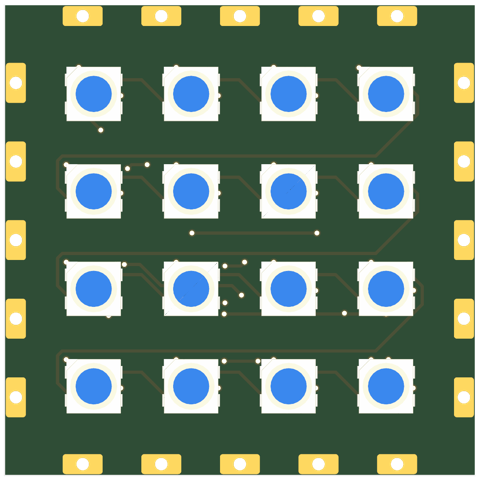
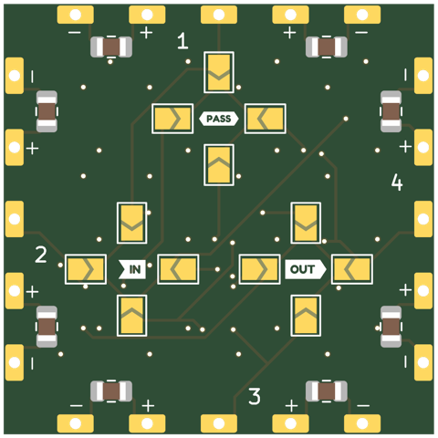
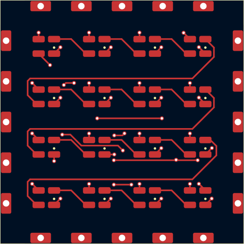
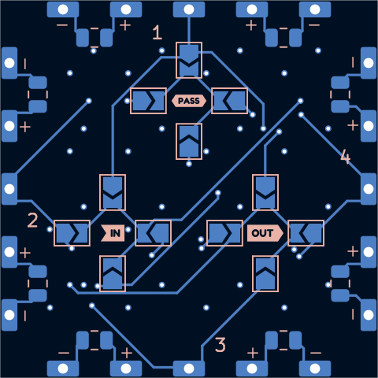
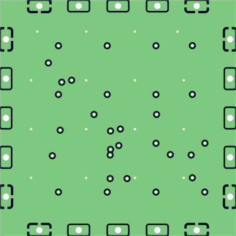
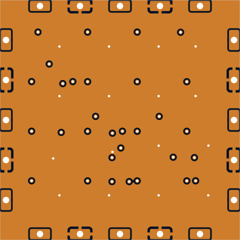

# sq30-3535x16-p6.2-pvia

4x4 WS2812B-Mini (3535) tile at 6.2mm pitch -- same LED and pitch as the triangle tri30-3535x10-p6.2-shallow-rot.

## At a glance

| | |
|---|---|
| Shape | square, 30 mm edge, 4 ports |
| LEDs | 16 x WS2812B-Mini (4 x 4) |
| Footprint | `tbc:LED_WS2812B-Mini_PLCC4_3.5x3.5mm_InnerPads` |
| LCSC | **TODO** |
| Pitch | 6.2 mm |
| Rotation | one rotation, DOUT to the right |
| Chain | raster |
| Edge connector | `edge_connector` (`tbc:edge_conn`) |
| Back side | generated: IN/OUT/PASS jumper hubs with 4 wings each (3.225 mm from the hub centre, hubs on a 7.0 mm circle), 2 caps per edge |
| Power vias | pattern |
| Router | internal |
| Revision | A |

## Name

| | |
|---|---|
| `sq30` | square, 30 mm edge |
| `3535x16` | 16 LEDs in the 3535 package |
| `p6.2` | 6.2 mm LED pitch |
| `pvia` | patterned power vias |

## Build

| | |
|---|---|
| DRC | 0 errors, 0 warnings, 0 unconnected |
| Front track | 208 mm |
| Back track | 177 mm |
| In2 hops | 0 mm |
| Vias | 47 |

## Renders

| Top | Bottom |
|---|---|
|  |  |

### Layers

| Front: F.Cu, silkscreen | Back, seen from below: B.Cu, silkscreen |
|---|---|
|  |  |

| In1: GND plane | In2: +5V plane (and a few hops) |
|---|---|
|  |  |

## Pixel map

LED index in the data chain -> position, mm from the board centre (y down, top view). Also in [pixelmap.json](pixelmap.json).

16 LEDs, 4 ports

| LED | x | y |
|---|---|---|
| 1 | -9.30 | -9.30 |
| 2 | -3.10 | -9.30 |
| 3 | 3.10 | -9.30 |
| 4 | 9.30 | -9.30 |
| 5 | -9.30 | -3.10 |
| 6 | -3.10 | -3.10 |
| 7 | 3.10 | -3.10 |
| 8 | 9.30 | -3.10 |
| 9 | -9.30 | 3.10 |
| 10 | -3.10 | 3.10 |
| 11 | 3.10 | 3.10 |
| 12 | 9.30 | 3.10 |
| 13 | -9.30 | 9.30 |
| 14 | -3.10 | 9.30 |
| 15 | 3.10 | 9.30 |
| 16 | 9.30 | 9.30 |

| Port | x | y | facing |
|---|---|---|---|
| P1 | 0.00 | -15.00 | -90 deg |
| P2 | 15.00 | 0.00 | 0 deg |
| P3 | 0.00 | 15.00 | 90 deg |
| P4 | -15.00 | 0.00 | 180 deg |

## Used in

- [cube--sq30-3535x16-p6.2-pvia](../../shapes/cube--sq30-3535x16-p6.2-pvia/README.md)
- [cuboctahedron--sq30-3535x16-p6.2-pvia+tri30-3535x10-p6.2-shallow-rot](../../shapes/cuboctahedron--sq30-3535x16-p6.2-pvia+tri30-3535x10-p6.2-shallow-rot/README.md)
- [square-pyramid--sq30-3535x16-p6.2-pvia+tri30-3535x10-p6.2-shallow-rot](../../shapes/square-pyramid--sq30-3535x16-p6.2-pvia+tri30-3535x10-p6.2-shallow-rot/README.md)
- [triangular-prism--sq30-3535x16-p6.2-pvia+tri30-3535x10-p6.2-shallow-rot](../../shapes/triangular-prism--sq30-3535x16-p6.2-pvia+tri30-3535x10-p6.2-shallow-rot/README.md)

## Files

- config: [boards/sq30-3535x16-p6.2-pvia.yaml](../../../boards/sq30-3535x16-p6.2-pvia.yaml)
- rebuild: `make all model BOARDS=sq30-3535x16-p6.2-pvia && make docs`
- KiCad project, gerbers, BOM/CPL: `build/sq30-3535x16-p6.2-pvia/` (not committed)
