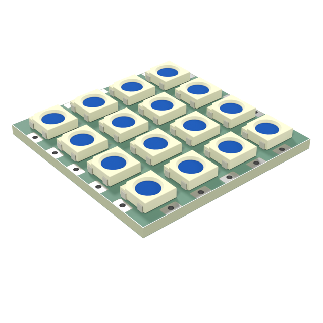
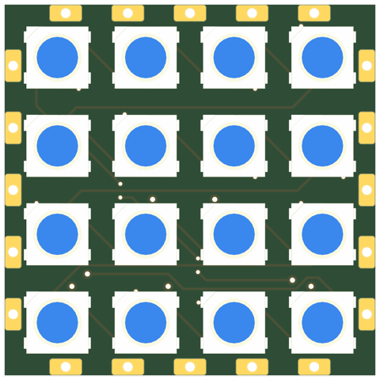
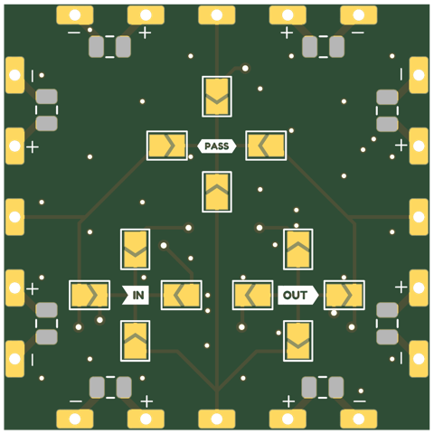
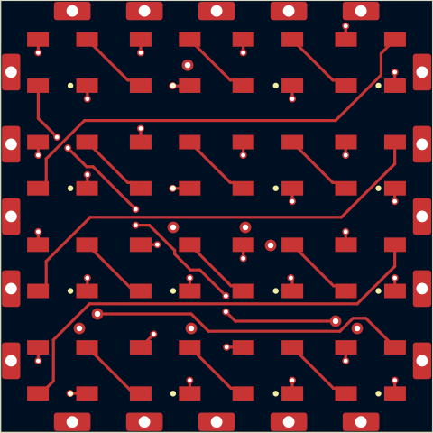
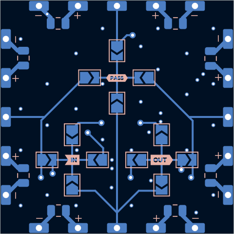
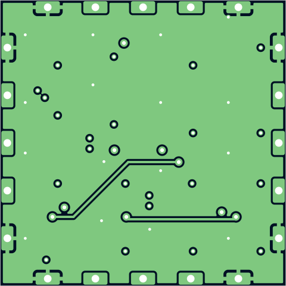
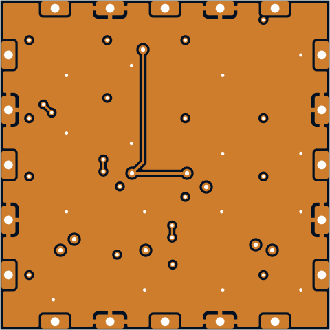

# sq30-5050x16-p7.112-tpl

4x4 WS2812B 5050 tile -- same form factor as thecube/led_board_v5.

## At a glance

| | |
|---|---|
| Shape | square, 30 mm edge, 4 ports |
| LEDs | 16 x WS2812B (4 x 4) |
| Footprint | `tbc:LED_WS2812B_PLCC4_5.0x5.0mm_InnerPads` |
| LCSC | C52917433 |
| Pitch | 7.112 mm |
| Rotation | one rotation, DOUT to the right |
| Chain | raster |
| Edge connector | from the template |
| Back side | hand-drawn template `square30` |
| Power vias | nearest |
| Router | internal |
| Revision | A |

## Name

| | |
|---|---|
| `sq30` | square, 30 mm edge |
| `5050x16` | 16 LEDs in the 5050 package |
| `p7.112` | 7.112 mm LED pitch |
| `tpl` | hand-drawn back side from a template |

## Build

| | |
|---|---|
| DRC | 0 errors, 0 warnings, 0 unconnected |
| Front track | 223 mm |
| Back track | 170 mm |
| In2 hops | 19.9 mm |
| Vias | 47 |

## Renders

| Top | Bottom |
|---|---|
|  |  |

### Layers

| Front: F.Cu, silkscreen | Back, seen from below: B.Cu, silkscreen |
|---|---|
|  |  |

| In1: GND plane | In2: +5V plane (and a few hops) |
|---|---|
|  |  |

## Pixel map

LED index in the data chain -> position, mm from the board centre (y down, top view). Also in [pixelmap.json](pixelmap.json).

16 LEDs, 4 ports

| LED | x | y |
|---|---|---|
| 1 | -10.67 | -10.67 |
| 2 | -3.56 | -10.67 |
| 3 | 3.56 | -10.67 |
| 4 | 10.67 | -10.67 |
| 5 | -10.67 | -3.56 |
| 6 | -3.56 | -3.56 |
| 7 | 3.56 | -3.56 |
| 8 | 10.67 | -3.56 |
| 9 | -10.67 | 3.56 |
| 10 | -3.56 | 3.56 |
| 11 | 3.56 | 3.56 |
| 12 | 10.67 | 3.56 |
| 13 | -10.67 | 10.67 |
| 14 | -3.56 | 10.67 |
| 15 | 3.56 | 10.67 |
| 16 | 10.67 | 10.67 |

| Port | x | y | facing |
|---|---|---|---|
| P1 | 0.00 | -15.00 | -90 deg |
| P2 | 15.00 | 0.00 | 0 deg |
| P3 | 0.00 | 15.00 | 90 deg |
| P4 | -15.00 | 0.00 | 180 deg |

## Files

- config: [boards/sq30-5050x16-p7.112-tpl.yaml](../../../boards/sq30-5050x16-p7.112-tpl.yaml)
- rebuild: `make all model BOARDS=sq30-5050x16-p7.112-tpl && make docs`
- KiCad project, gerbers, BOM/CPL: `build/sq30-5050x16-p7.112-tpl/` (not committed)
