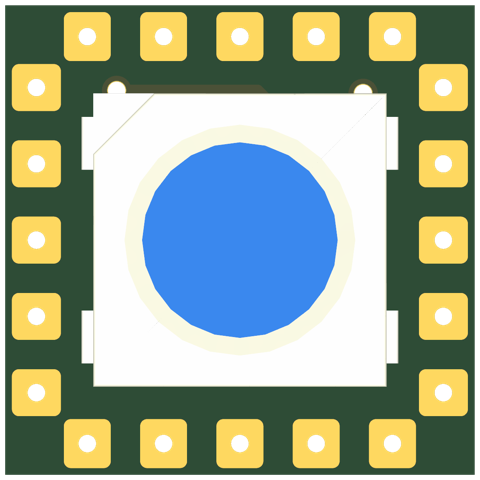
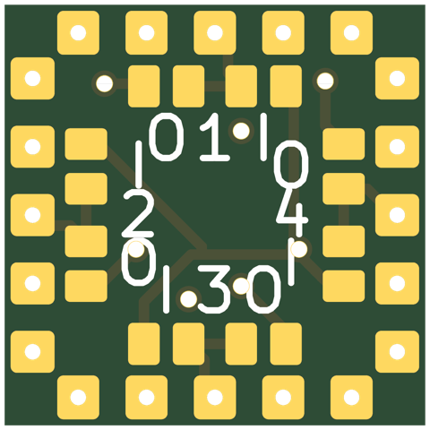
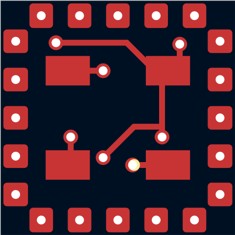
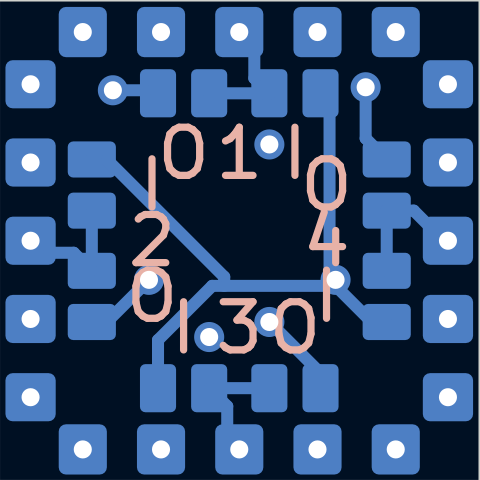
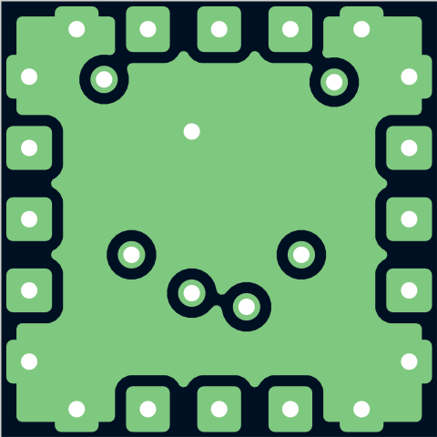
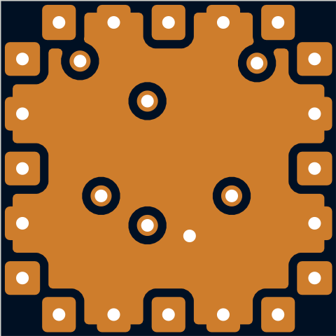

# sq8-5050x1-p5.5-micro-grp-nopass-pvia

Smallest 1-LED 5050 tile: one WS2812B on an 8mm square (the front alone would fit 7.5mm), no cap, no PASS hub. Jumpers grouped by port: an IN/OUT pair lying along each edge, PORT pads in the middle by the connector's port pad, and the IN and OUT hubs routed as rings (hopping on the front and In2). Mates only with other micro-connector tiles. (One LED: the pitch is nominal.)

## At a glance

| | |
|---|---|
| Shape | square, 8 mm edge, 4 ports |
| LEDs | 1 x WS2812B (1 x 1) |
| Footprint | `tbc:LED_WS2812B_PLCC4_5.0x5.0mm_InnerPads` |
| LCSC | C52917433 |
| Pitch | 5.5 mm |
| Rotation | one rotation, DOUT to the right |
| Chain | raster |
| Edge connector | `edge_connector_micro` (`tbc:edge_conn_micro`) |
| Back side | generated: IN/OUT jumpers grouped by port (1.85 mm apart, 1.55 mm in from the edge), hubs routed as rings, no caps |
| Power vias | pattern |
| Router | internal |
| Revision | A |

## Name

| | |
|---|---|
| `sq8` | square, 8 mm edge |
| `5050x1` | 1 LEDs in the 5050 package |
| `p5.5` | 5.5 mm LED pitch |
| `micro` | micro edge connector (small tiles) |
| `grp` | jumpers grouped by port |
| `nopass` | no PASS hub |
| `pvia` | patterned power vias |

## Build

| | |
|---|---|
| DRC | 0 errors, 0 warnings, 0 unconnected |
| Front track | 12 mm |
| Back track | 23 mm |
| In2 hops | 0 mm |
| Vias | 7 |

## Renders

| Top | Bottom |
|---|---|
|  |  |

### Layers

| Front: F.Cu, silkscreen | Back, seen from below: B.Cu, silkscreen |
|---|---|
|  |  |

| In1: GND plane | In2: +5V plane (and a few hops) |
|---|---|
|  |  |

## Pixel map

LED index in the data chain -> position, mm from the board centre (y down, top view). Also in [pixelmap.json](pixelmap.json).

1 LEDs, 4 ports

| LED | x | y |
|---|---|---|
| 1 | 0.00 | 0.00 |

| Port | x | y | facing |
|---|---|---|---|
| P1 | 0.00 | -4.00 | -90 deg |
| P2 | 4.00 | 0.00 | 0 deg |
| P3 | 0.00 | 4.00 | 90 deg |
| P4 | -4.00 | 0.00 | 180 deg |

## Used in

- [cube--sq8-5050x1-p5.5-micro-grp-nopass-pvia](../../shapes/cube--sq8-5050x1-p5.5-micro-grp-nopass-pvia/README.md)

## Files

- config: [boards/sq8-5050x1-p5.5-micro-grp-nopass-pvia.yaml](../../../boards/sq8-5050x1-p5.5-micro-grp-nopass-pvia.yaml)
- rebuild: `make all model BOARDS=sq8-5050x1-p5.5-micro-grp-nopass-pvia && make docs`
- KiCad project, gerbers, BOM/CPL: `build/sq8-5050x1-p5.5-micro-grp-nopass-pvia/` (not committed)
