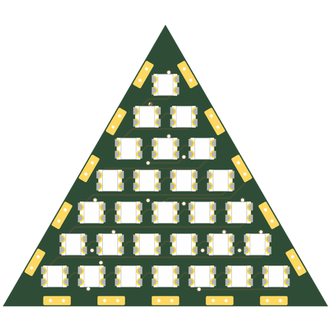
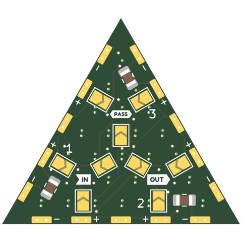
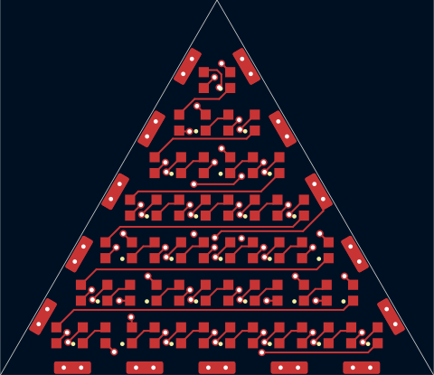
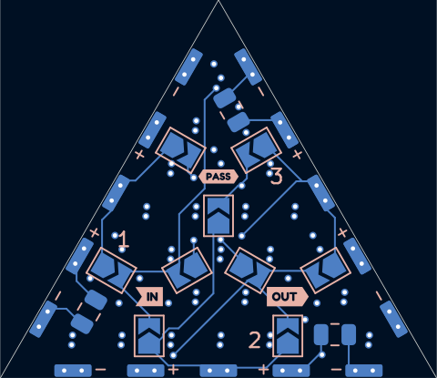
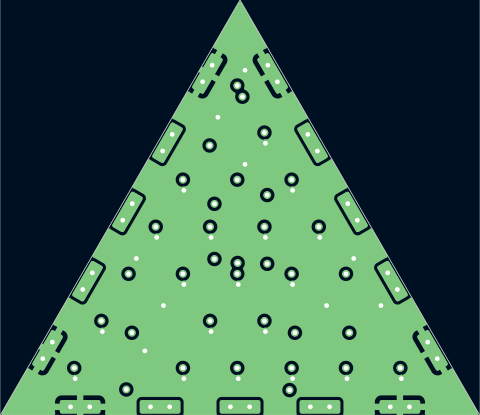
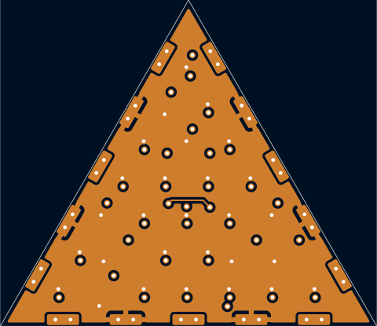

# tri30-2020x28-p3.4-shallow-pvia

Triangle tile, 7+6+...+1 WS2812B-2020 at 3.4mm pitch -- same LED and pitch as the 8x8 sq30-2020x64-p3.4-tpl. 0.28mm from the LED pads to the shallow connector pads.

## At a glance

| | |
|---|---|
| Shape | triangle, 30 mm edge, 3 ports |
| LEDs | 28 x WS2812B-2020 (7 + 6 + 5 + 4 + 3 + 2 + 1) |
| Footprint | `tbc:LED_WS2812B-2020_PLCC4_2.0x2.0mm` |
| LCSC | C52917434 |
| Pitch | 3.4 mm |
| Rotation | one rotation, DOUT to the right |
| Chain | raster |
| Edge connector | `edge_connector_shallow` (`tbc:edge_conn_shallow`) |
| Back side | generated: IN/OUT/PASS jumper hubs with 3 wings each (3.0 mm from the hub centre, hubs on a 5.5 mm circle), 1 cap per edge |
| Power vias | pattern |
| Router | internal |
| Revision | A |

## Name

| | |
|---|---|
| `tri30` | triangle, 30 mm edge |
| `2020x28` | 28 LEDs in the 2020 package |
| `p3.4` | 3.4 mm LED pitch |
| `shallow` | shallow edge-connector pads |
| `pvia` | patterned power vias |

## Build

| | |
|---|---|
| DRC | 0 errors, 0 warnings, 0 unconnected |
| Front track | 195 mm |
| Back track | 98 mm |
| In2 hops | 3.6 mm |
| Vias | 63 |

## Renders

| Top | Bottom |
|---|---|
|  |  |

### Layers

| Front: F.Cu, silkscreen | Back, seen from below: B.Cu, silkscreen |
|---|---|
|  |  |

| In1: GND plane | In2: +5V plane (and a few hops) |
|---|---|
|  |  |

## Pixel map

LED index in the data chain -> position, mm from the board centre (y down, top view). Also in [pixelmap.json](pixelmap.json).

28 LEDs, 3 ports

| LED | x | y |
|---|---|---|
| 1 | 0.00 | -11.78 |
| 2 | -1.70 | -8.83 |
| 3 | 1.70 | -8.83 |
| 4 | -3.40 | -5.89 |
| 5 | 0.00 | -5.89 |
| 6 | 3.40 | -5.89 |
| 7 | -5.10 | -2.94 |
| 8 | -1.70 | -2.94 |
| 9 | 1.70 | -2.94 |
| 10 | 5.10 | -2.94 |
| 11 | -6.80 | 0.00 |
| 12 | -3.40 | 0.00 |
| 13 | 0.00 | 0.00 |
| 14 | 3.40 | 0.00 |
| 15 | 6.80 | 0.00 |
| 16 | -8.50 | 2.94 |
| 17 | -5.10 | 2.94 |
| 18 | -1.70 | 2.94 |
| 19 | 1.70 | 2.94 |
| 20 | 5.10 | 2.94 |
| 21 | 8.50 | 2.94 |
| 22 | -10.20 | 5.89 |
| 23 | -6.80 | 5.89 |
| 24 | -3.40 | 5.89 |
| 25 | 0.00 | 5.89 |
| 26 | 3.40 | 5.89 |
| 27 | 6.80 | 5.89 |
| 28 | 10.20 | 5.89 |

| Port | x | y | facing |
|---|---|---|---|
| P1 | 7.50 | -4.33 | -30 deg |
| P2 | 0.00 | 8.66 | 90 deg |
| P3 | -7.50 | -4.33 | -150 deg |

## Used in

- [cuboctahedron--sq30-2020x64-p3.4-tpl+tri30-2020x28-p3.4-shallow-pvia](../../shapes/cuboctahedron--sq30-2020x64-p3.4-tpl+tri30-2020x28-p3.4-shallow-pvia/README.md)

## Files

- config: [boards/tri30-2020x28-p3.4-shallow-pvia.yaml](../../../boards/tri30-2020x28-p3.4-shallow-pvia.yaml)
- rebuild: `make all model BOARDS=tri30-2020x28-p3.4-shallow-pvia && make docs`
- KiCad project, gerbers, BOM/CPL: `build/tri30-2020x28-p3.4-shallow-pvia/` (not committed)
