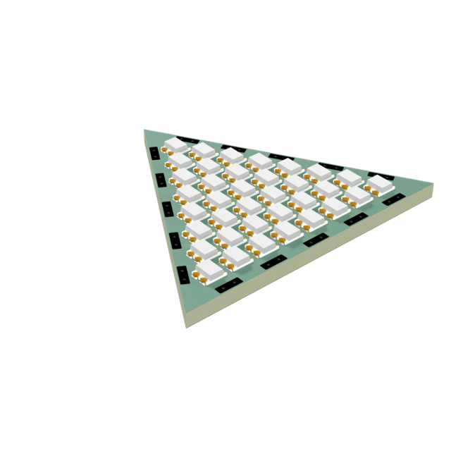
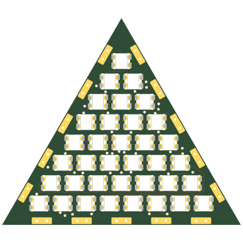
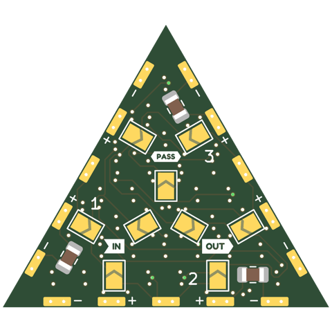
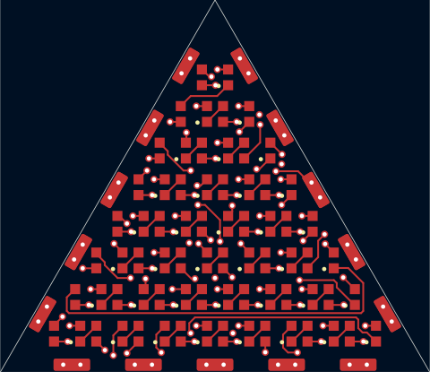
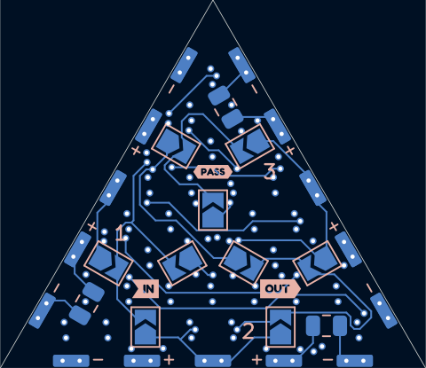
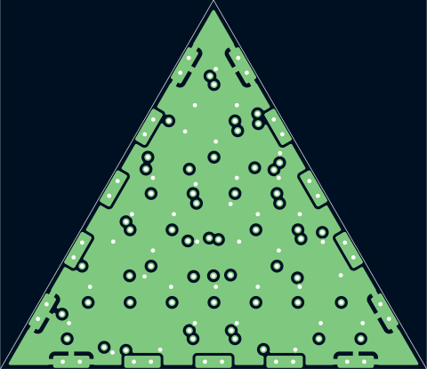
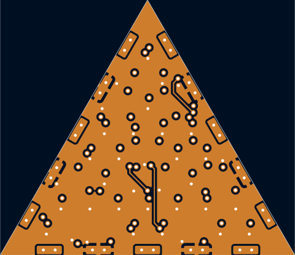

# tri30-2020x36-p2.95-shallow-pvia

Triangle tile, 8+7+...+1 WS2812B-2020 at 2.95mm pitch: the most 2020s a 30mm triangle takes, 8 per side like sq30-2020x64-p2.95-pvia. The LED pads (1.55mm towards a slanted edge) set the pitch: 2.95mm leaves 0.2mm to the shallow connector pads.

## At a glance

| | |
|---|---|
| Shape | triangle, 30 mm edge, 3 ports |
| LEDs | 36 x WS2812B-2020 (8 + 7 + 6 + 5 + 4 + 3 + 2 + 1) |
| Footprint | `tbc:LED_WS2812B-2020_PLCC4_2.0x2.0mm` |
| LCSC | C52917434 |
| Pitch | 2.95 mm |
| Rotation | one rotation, DOUT to the right |
| Chain | raster |
| Edge connector | `edge_connector_shallow` (`tbc:edge_conn_shallow`) |
| Back side | generated: IN/OUT/PASS jumper hubs with 3 wings each (3.0 mm from the hub centre, hubs on a 5.5 mm circle), 1 cap per edge |
| Power vias | pattern |
| Router | internal |
| Revision | A |

## Name

| | |
|---|---|
| `tri30` | triangle, 30 mm edge |
| `2020x36` | 36 LEDs in the 2020 package |
| `p2.95` | 2.95 mm LED pitch |
| `shallow` | shallow edge-connector pads |
| `pvia` | patterned power vias |

## Build

| | |
|---|---|
| DRC | 0 errors, 0 warnings, 0 unconnected |
| Front track | 174 mm |
| Back track | 172 mm |
| In2 hops | 14.4 mm |
| Vias | 92 |

## Renders

| Top | Bottom |
|---|---|
|  |  |

### Layers

| Front: F.Cu, silkscreen | Back, seen from below: B.Cu, silkscreen |
|---|---|
|  |  |

| In1: GND plane | In2: +5V plane (and a few hops) |
|---|---|
|  |  |

## Pixel map

LED index in the data chain -> position, mm from the board centre (y down, top view). Also in [pixelmap.json](pixelmap.json).

36 LEDs, 3 ports

| LED | x | y |
|---|---|---|
| 1 | 0.00 | -11.92 |
| 2 | -1.48 | -9.37 |
| 3 | 1.48 | -9.37 |
| 4 | -2.95 | -6.81 |
| 5 | 0.00 | -6.81 |
| 6 | 2.95 | -6.81 |
| 7 | -4.42 | -4.26 |
| 8 | -1.48 | -4.26 |
| 9 | 1.48 | -4.26 |
| 10 | 4.42 | -4.26 |
| 11 | -5.90 | -1.70 |
| 12 | -2.95 | -1.70 |
| 13 | 0.00 | -1.70 |
| 14 | 2.95 | -1.70 |
| 15 | 5.90 | -1.70 |
| 16 | -7.38 | 0.85 |
| 17 | -4.42 | 0.85 |
| 18 | -1.48 | 0.85 |
| 19 | 1.48 | 0.85 |
| 20 | 4.42 | 0.85 |
| 21 | 7.38 | 0.85 |
| 22 | -8.85 | 3.41 |
| 23 | -5.90 | 3.41 |
| 24 | -2.95 | 3.41 |
| 25 | 0.00 | 3.41 |
| 26 | 2.95 | 3.41 |
| 27 | 5.90 | 3.41 |
| 28 | 8.85 | 3.41 |
| 29 | -10.32 | 5.96 |
| 30 | -7.38 | 5.96 |
| 31 | -4.42 | 5.96 |
| 32 | -1.48 | 5.96 |
| 33 | 1.48 | 5.96 |
| 34 | 4.42 | 5.96 |
| 35 | 7.38 | 5.96 |
| 36 | 10.32 | 5.96 |

| Port | x | y | facing |
|---|---|---|---|
| P1 | 7.50 | -4.33 | -30 deg |
| P2 | 0.00 | 8.66 | 90 deg |
| P3 | -7.50 | -4.33 | -150 deg |

## Used in

- [cuboctahedron--sq30-2020x64-p2.95-pvia+tri30-2020x36-p2.95-shallow-pvia](../../shapes/cuboctahedron--sq30-2020x64-p2.95-pvia+tri30-2020x36-p2.95-shallow-pvia/README.md)
- [icosahedron--tri30-2020x36-p2.95-shallow-pvia](../../shapes/icosahedron--tri30-2020x36-p2.95-shallow-pvia/README.md)

## Files

- config: [boards/tri30-2020x36-p2.95-shallow-pvia.yaml](../../../boards/tri30-2020x36-p2.95-shallow-pvia.yaml)
- rebuild: `make all model BOARDS=tri30-2020x36-p2.95-shallow-pvia && make docs`
- KiCad project, gerbers, BOM/CPL: `build/tri30-2020x36-p2.95-shallow-pvia/` (not committed)
