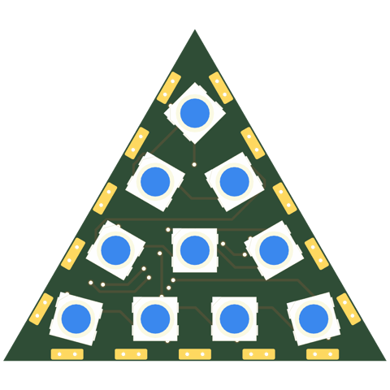
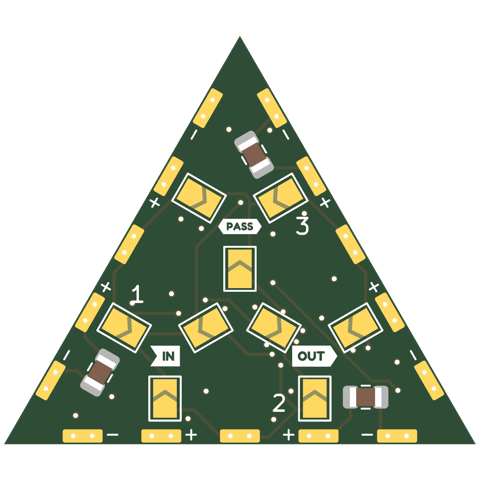
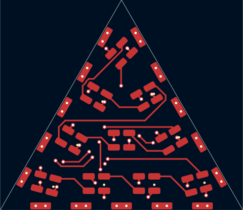
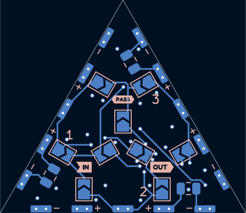
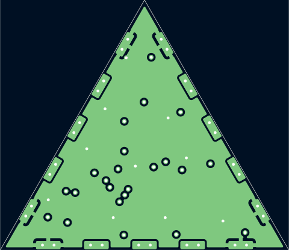
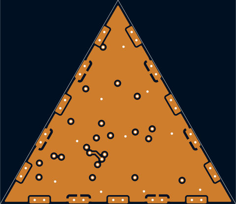

# tri30-3535x10-p6.2-shallow-rot

Triangle tile, 4+3+2+1 WS2812B-Mini (3535) at 6.2mm pitch: outer-ring LEDs turned to keep their bodies off the edge (one rotation tops out at ~5.8mm).

## At a glance

| | |
|---|---|
| Shape | triangle, 30 mm edge, 3 ports |
| LEDs | 10 x WS2812B-Mini (4 + 3 + 2 + 1) |
| Footprint | `tbc:LED_WS2812B-Mini_PLCC4_3.5x3.5mm_InnerPads` |
| LCSC | **TODO** |
| Pitch | 6.2 mm |
| Rotation | outer LEDs turned (15 deg steps) to clear the edge |
| Chain | raster |
| Edge connector | `edge_connector_shallow` (`tbc:edge_conn_shallow`) |
| Back side | generated: IN/OUT/PASS jumper hubs with 3 wings each (3.0 mm from the hub centre, hubs on a 5.5 mm circle), 1 cap per edge |
| Power vias | nearest |
| Router | internal |
| Revision | A |

## Name

| | |
|---|---|
| `tri30` | triangle, 30 mm edge |
| `3535x10` | 10 LEDs in the 3535 package |
| `p6.2` | 6.2 mm LED pitch |
| `shallow` | shallow edge-connector pads |
| `rot` | outer LEDs turned to clear the edge |

## Build

| | |
|---|---|
| DRC | 0 errors, 0 warnings, 0 unconnected |
| Front track | 112 mm |
| Back track | 100 mm |
| In2 hops | 1.9 mm |
| Vias | 33 |

## Renders

| Top | Bottom |
|---|---|
|  |  |

### Layers

| Front: F.Cu, silkscreen | Back, seen from below: B.Cu, silkscreen |
|---|---|
|  |  |

| In1: GND plane | In2: +5V plane (and a few hops) |
|---|---|
|  |  |

## Pixel map

LED index in the data chain -> position, mm from the board centre (y down, top view). Also in [pixelmap.json](pixelmap.json).

10 LEDs, 3 ports

| LED | x | y |
|---|---|---|
| 1 | 0.00 | -10.74 |
| 2 | -3.10 | -5.37 |
| 3 | 3.10 | -5.37 |
| 4 | -6.20 | 0.00 |
| 5 | 0.00 | 0.00 |
| 6 | 6.20 | 0.00 |
| 7 | -9.30 | 5.37 |
| 8 | -3.10 | 5.37 |
| 9 | 3.10 | 5.37 |
| 10 | 9.30 | 5.37 |

| Port | x | y | facing |
|---|---|---|---|
| P1 | 7.50 | -4.33 | -30 deg |
| P2 | 0.00 | 8.66 | 90 deg |
| P3 | -7.50 | -4.33 | -150 deg |

## Used in

- [cuboctahedron--sq30-3535x16-p6.2-pvia+tri30-3535x10-p6.2-shallow-rot](../../shapes/cuboctahedron--sq30-3535x16-p6.2-pvia+tri30-3535x10-p6.2-shallow-rot/README.md)
- [icosahedron--tri30-3535x10-p6.2-shallow-rot](../../shapes/icosahedron--tri30-3535x10-p6.2-shallow-rot/README.md)
- [octahedron--tri30-3535x10-p6.2-shallow-rot](../../shapes/octahedron--tri30-3535x10-p6.2-shallow-rot/README.md)
- [square-pyramid--sq30-3535x16-p6.2-pvia+tri30-3535x10-p6.2-shallow-rot](../../shapes/square-pyramid--sq30-3535x16-p6.2-pvia+tri30-3535x10-p6.2-shallow-rot/README.md)
- [tetrahedron--tri30-3535x10-p6.2-shallow-rot](../../shapes/tetrahedron--tri30-3535x10-p6.2-shallow-rot/README.md)
- [triangular-prism--sq30-3535x16-p6.2-pvia+tri30-3535x10-p6.2-shallow-rot](../../shapes/triangular-prism--sq30-3535x16-p6.2-pvia+tri30-3535x10-p6.2-shallow-rot/README.md)

## Files

- config: [boards/tri30-3535x10-p6.2-shallow-rot.yaml](../../../boards/tri30-3535x10-p6.2-shallow-rot.yaml)
- rebuild: `make all model BOARDS=tri30-3535x10-p6.2-shallow-rot && make docs`
- KiCad project, gerbers, BOM/CPL: `build/tri30-3535x10-p6.2-shallow-rot/` (not committed)
