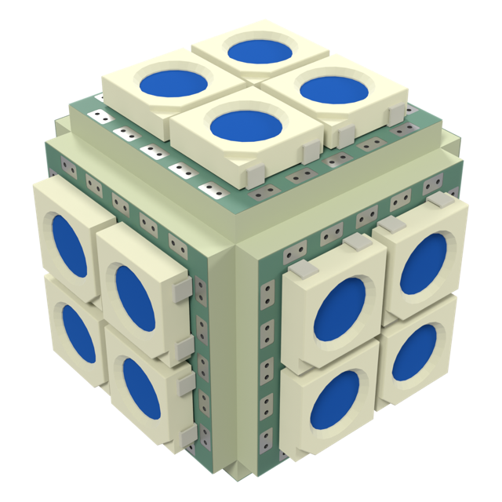

# cube--sq13-5050x4-p5.5-mini-pvia

The smallest 5050 cube: six 13mm mini tiles, 2x2 WS2812B each, 24 LEDs.

| | |
|---|---|
| Solid | cube, 6 faces |
| Tiles | 6 x square |
| LEDs | 24 (6 x 4) |
| Size | 19 x 19 x 19 mm (with LEDs) |

## Boards

- **6 x [sq13-5050x4-p5.5-mini-pvia](../../boards/sq13-5050x4-p5.5-mini-pvia/README.md)**: 4 x WS2812B at 5.5 mm

## Files

- config: [shapes/cube--sq13-5050x4-p5.5-mini-pvia.yaml](../../../shapes/cube--sq13-5050x4-p5.5-mini-pvia.yaml)
- rebuild: `make shapes SHAPES=cube--sq13-5050x4-p5.5-mini-pvia && make docs`
- 3D model: `build/shapes/cube--sq13-5050x4-p5.5-mini-pvia.glb` (not committed; opens in Blender or any glTF viewer)
