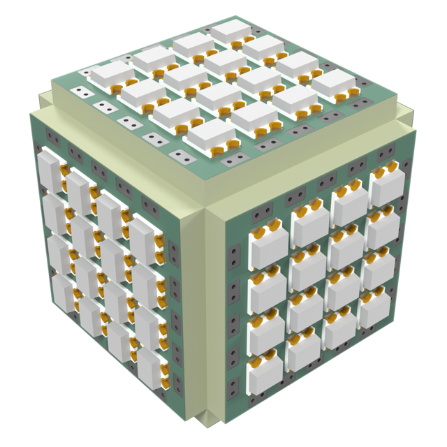

# cube--sq13.5-2020x16-p2.85-mini-pvia

The small 2020 cube: six 13.5mm mini tiles, 4x4 WS2812B-2020 each, 96 LEDs.

| | |
|---|---|
| Solid | cube, 6 faces |
| Tiles | 6 x square |
| LEDs | 96 (6 x 16) |
| Size | 18 x 18 x 18 mm (with LEDs) |

## Boards

- **6 x [sq13.5-2020x16-p2.85-mini-pvia](../../boards/sq13.5-2020x16-p2.85-mini-pvia/README.md)**: 16 x WS2812B-2020 at 2.85 mm

## Files

- config: [shapes/cube--sq13.5-2020x16-p2.85-mini-pvia.yaml](../../../shapes/cube--sq13.5-2020x16-p2.85-mini-pvia.yaml)
- rebuild: `make shapes SHAPES=cube--sq13.5-2020x16-p2.85-mini-pvia && make docs`
- 3D model: `build/shapes/cube--sq13.5-2020x16-p2.85-mini-pvia.glb` (not committed; opens in Blender or any glTF viewer)
