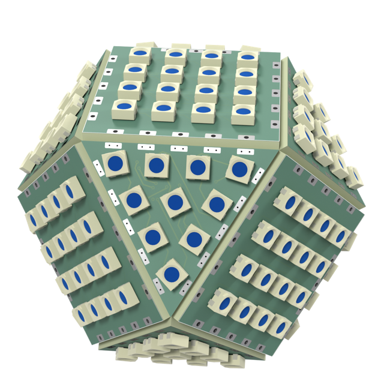

# cuboctahedron--sq30-3535x16-p6.2-pvia+tri30-3535x10-p6.2-shallow-rot

Eight triangles and six squares, 176 LEDs.

| | |
|---|---|
| Solid | cuboctahedron, 14 faces |
| Tiles | 6 x square, 8 x triangle |
| LEDs | 176 (6 x 16 + 8 x 10) |
| Size | 49 x 49 x 49 mm (with LEDs) |

## Boards

- **6 x [sq30-3535x16-p6.2-pvia](../../boards/sq30-3535x16-p6.2-pvia/README.md)**: 16 x WS2812B-Mini at 6.2 mm
- **8 x [tri30-3535x10-p6.2-shallow-rot](../../boards/tri30-3535x10-p6.2-shallow-rot/README.md)**: 10 x WS2812B-Mini at 6.2 mm

## Files

- config: [shapes/cuboctahedron--sq30-3535x16-p6.2-pvia+tri30-3535x10-p6.2-shallow-rot.yaml](../../../shapes/cuboctahedron--sq30-3535x16-p6.2-pvia+tri30-3535x10-p6.2-shallow-rot.yaml)
- rebuild: `make shapes SHAPES=cuboctahedron--sq30-3535x16-p6.2-pvia+tri30-3535x10-p6.2-shallow-rot && make docs`
- 3D model: `build/shapes/cuboctahedron--sq30-3535x16-p6.2-pvia+tri30-3535x10-p6.2-shallow-rot.glb` (not committed; opens in Blender or any glTF viewer)
